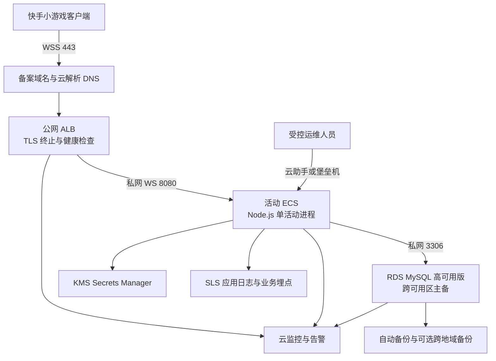
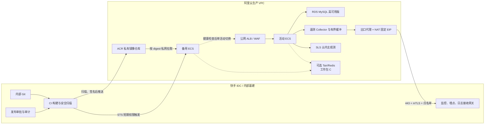

# 斗地主服务端阿里云两期生产部署方案

> 项目：老铁斗地主（APPID：`ks699465320497476962`）  
> 文档状态：评审稿  
> 更新时间：2026-08-18  
> 适用范围：服务端生产部署、资源采购、安全评审、发布运维、监控埋点与 IDC 基建接入

## 1. 文档目标

本方案将生产建设拆分为两个阶段：

- **一期：阿里云最小可用集**。在不依赖快手 IDC 的前提下，尽快形成可安全上线、可监控、可定位、可备份、可回滚的阿里云生产环境。
- **二期：可用性和运维体系升级**。在一期稳定运行和获得真实容量数据后，提高故障恢复与发布自动化能力，安全接入快手 IDC 的 CI/CD、监控和埋点平台，并在业务需要时演进到多实例分片。

方案遵循以下优先级：

1. 资金与身份数据正确性高于可用性数字；
2. 业务正确性高于形式上的多实例；
3. IDC 不可用不得影响玩家主链路；
4. 密钥不进入代码、镜像和普通日志；
5. 所有发布和高风险运维操作必须可审计、可回滚；
6. 先用一期真实数据验证容量，再决定二期规格和分布式改造范围。

---

## 2. 当前系统边界

### 2.1 已具备能力

当前服务端具备：

- Node.js + `ws` WebSocket 服务；
- 服务端权威的发牌、回合、出牌与结算；
- 快手登录、严格认证模式和 HMAC 身份派生；
- MySQL-only 持久化实现，所有环境统一使用 MySQL / InnoDB；
- 钱包流水幂等约束与 InnoDB 事务；
- 对局和关键事件审计；
- 单连接协议校验、消息大小限制和进程内限流；
- 机器人匹配和服务端自动行动；
- 启动时检查 MySQL 核心表是否完整。

### 2.2 核心限制

以下状态仍在单个 Node.js 进程内存中：

- 房间和牌局状态；
- 匹配队列与匹配会话；
- 加入预约和一次性票据；
- WebSocket 连接状态；
- 断线重连计时器；
- 行动倒计时与机器人调度器；
- 进程内限流桶；
- 平台 session key 缓存。

因此当前版本：

- 只保证**单活动进程**业务正确；
- 不允许将两个独立实例同时以正常权重加入负载均衡；
- 进程或 ECS 故障会丢失进行中的牌局；
- RDS 高可用可以保护已提交数据，但不能恢复内存牌局；
- 普通粘性会话不能替代匹配队列、房间归属和分布式一致性。

### 2.3 上线前代码阻塞项

一期上线前至少完成：

1. 将 WebSocket 挂载到 HTTP Server，并增加 `/healthz` 和 `/readyz`；
2. 同时处理 `SIGTERM` 和 `SIGINT`；
3. 支持 draining：停止新匹配，等待存量牌局，超时后安全退出；
4. 移除客户端硬编码内网 `ws://IP:8080`，生产构建注入 `wss://正式域名`；
5. 增加生产环境变量完整性校验；
6. 输出结构化 JSON 日志并统一过滤 token、session key 和 secret；
7. 增加 `serverVersion`、`serverGenerationId` 和关键业务指标；
8. 定义进程异常后未完成牌局的 `aborted` 与幂等补偿规则。

---

## 3. 两期范围总览

| 维度 | 一期：阿里云最小可用集 | 二期：高可用、IDC 互通与降本 |
|---|---|---|
| 建设目标 | 可安全上线、可观测、可备份、可人工恢复 | 自动化发布、快速切换、统一观测、减少人工操作 |
| IDC 依赖 | 无 | 有限、受控、可降级 |
| 应用实例 | 1 台活动 ECS | 活动 + 备用；业务需要时再演进分片 |
| 数据库 | RDS MySQL 高可用版 | 保留高可用，补充演练、跨地域备份与容量治理 |
| 流量入口 | 公网 ALB + WSS | ALB + WAF；按风险评估 DDoS 高防 |
| 镜像/制品 | 阿里云 ACR 或版本化制品 | 快手 CI 构建、扫描、签名并推送 ACR |
| 发布方式 | 标准脚本 + 人工审批 + 低峰发布 | 内部 CI/CD + STS + 云助手/部署代理 + 自动回滚 |
| 监控 | SLS + 云监控 + 基础业务埋点 | 保留云内主观测并向 IDC 异步上报 |
| 状态高可用 | 不支持牌局无损切换 | 先做单活动快速切换；多实例需 Tair/Redis 改造 |
| 运维目标 | 有手册、有人能恢复 | 自动化、最小权限、可审计、减少登录主机 |

### 3.1 阶段原则

- 一期不等待 IDC 网络、证书、CI/CD 和内部监控接入。
- 二期不能为了多实例而直接复制当前进程；必须先迁移共享状态或建立明确分片。
- 一期和二期都保留阿里云云内监控，IDC 观测平台不能成为唯一观测入口。
- 二期 IDC 断链时，游戏登录、匹配、对局、结算不受影响。

---

# 第一部分：一期——阿里云最小可用集

## 4. 一期目标与非目标

### 4.1 目标

一期完成后应满足：

- 玩家通过备案域名和 WSS 安全访问服务；
- 服务端和数据库均不直接暴露公网业务端口；
- 生产使用 RDS MySQL，资金与流水有事务、备份和恢复能力；
- 密钥通过阿里云 KMS 或等价安全方式注入；
- 有基础设施监控、应用日志、关键业务埋点和告警；
- 有标准发布、回滚、数据库迁移和故障恢复手册；
- 单实例故障后可在明确时间内人工恢复服务；
- 进行中牌局丢失时有一致的中止和补偿规则。

### 4.2 非目标

一期不承诺：

- 多活动实例；
- 进行中牌局无损故障转移；
- 自动扩缩容；
- 快手 IDC 网络互通；
- 快手 CI/CD 自动发布；
- 全量日志实时回传 IDC；
- 地域级双活；
- Redis/Tair 分布式状态。

---

## 5. 一期架构



### 5.1 网络分区

建议一个生产 VPC，覆盖两个可用区：

| 子网 | 用途 | 公网暴露 |
|---|---|---|
| 接入 vSwitch A/B | ALB 多可用区 | 仅 ALB 443 |
| 应用 vSwitch | 活动 ECS | 否 |
| 数据库 vSwitch A/B | RDS 主备 | 否 |

一期 ECS 不绑定公网 EIP。管理优先使用：

1. 阿里云云助手；
2. 堡垒机；
3. 受控 VPN/跳板机。

禁止临时开放 ECS `22` 或 RDS `3306` 到 `0.0.0.0/0`。

---

## 6. 一期采购清单

### 6.1 推荐基线

以下规格以正式小流量上线、目标压测 2,000 长连接为基线，最终承载值以压测为准。

| 产品 | 推荐规格 | 数量 | 必要性 |
|---|---|---:|---|
| VPC | 单生产 VPC | 1 | 必需 |
| vSwitch | 跨 2 个可用区 | 4～6 | 必需 |
| 公网 ALB | 标准版，多可用区 | 1 | 必需 |
| SSL 证书 | 正式 WSS 域名 | 1 | 必需 |
| 云解析 DNS | 正式域名记录 | 1 | 必需 |
| ECS | 4C8G，100 GB ESSD | 1 | 必需 |
| RDS MySQL | 高可用版 4C8G | 1 | 必需 |
| RDS 存储 | 200 GB ESSD，可扩容 | 1 | 必需 |
| KMS Secrets Manager | 通用 secret + DB 凭据 | 1 套 | 建议必需 |
| SLS | Project + Logstore | 1 套 | 必需 |
| 云监控 | ECS/RDS/ALB 告警 | 1 套 | 必需 |
| ActionTrail | 云操作审计 | 1 套 | 必需 |
| ACR 私有仓库 | 基础版或企业版按需 | 1 | 推荐 |
| RDS 跨地域备份 | 按业务数据价值开启 | 1 | 推荐 |
| WAF | 一期可后置到正式放量前 | 1 | 可选 |
| DDoS 高防 | 按推广与攻击风险采购 | 1 | 可选 |

### 6.2 一期成本口径

粗略预算用于立项，不替代阿里云价格计算器和企业协议价：

- 基础生产环境约 `4,000～8,000 元/月`；
- 公网流量、SLS 写入量、备份量、WAF 和高防另行核算；
- 若首发仅数百长连接，可降低 RDS/ECS 规格，但不建议取消 ALB、备份和基础观测；
- 包年包月适合稳定基础资源，公网流量和日志可按量计费并设置预算告警。

---

## 7. 一期安全设计

### 7.1 安全组矩阵

| 来源 | 目标 | 端口 | 策略 |
|---|---|---:|---|
| 公网 | ALB | 443 | 允许 |
| 公网 | ECS | 任意 | 拒绝 |
| ALB 安全组 | ECS | 8080 | 允许 |
| ECS 安全组 | RDS | 3306 | 允许 |
| 其他资源 | RDS | 3306 | 默认拒绝 |
| 运维入口 | ECS | 云助手/受控 SSH | 按需、可审计 |
| ECS | KMS/SLS/必要公网 API | 443 | 最小化允许 |

### 7.2 密钥管理

至少纳入 KMS：

- `DDZ_AUTH_SECRET`；
- `DDZ_KWAI_APP_SECRET`；
- RDS 用户名和密码；
- 后续埋点签名密钥。

要求：

- 真实密钥不得提交 Git；
- 不得打进镜像；
- 不得打印到日志；
- ECS 通过 RAM 实例角色读取指定 secret；
- 快手身份派生盐为代码内置常量，修改它等同全量账号迁移；
- 身份盐、认证密钥和埋点脱敏盐必须分离。

### 7.3 生产账号

RDS 至少拆分：

- migration 账号：发布窗口使用，可执行 DDL；
- application 账号：仅 `SELECT/INSERT/UPDATE/DELETE`；
- audit 账号：只读，按需创建。

应用运行账号不得拥有删库、创建用户和授权权限。

---

## 8. 一期流量与 ALB 配置

| 配置 | 推荐值 |
|---|---|
| 外部协议 | HTTPS/WSS |
| 外部端口 | 443 |
| 后端协议 | HTTP/WS |
| 后端端口 | 8080 |
| ALB 空闲超时 | 600 秒 |
| 客户端心跳 | 20～30 秒 |
| 后端数量 | 仅 1 台活动 ECS |
| 健康检查 | `/readyz` |
| 访问日志 | 投递 SLS |

健康端点语义：

- `/healthz`：进程存活，供本机和诊断使用；
- `/readyz`：DB 可用、schema 完整、初始化完成且非 draining；
- draining 时 `/readyz` 返回 `503`，ALB 不再转发新连接。

一期即使采购第二台 ECS，也不能将两台都以正常权重接入 ALB。

---

## 9. 一期基础监控与埋点

### 9.1 监控分层

一期不追求大而全，但必须覆盖四层：

1. **基础设施层**：ALB、ECS、RDS；
2. **运行时层**：Node.js 堆、GC、事件循环、进程存活；
3. **业务层**：连接、匹配、牌局、结算；
4. **安全与审计层**：认证失败、限流、异常请求、云资源操作。

### 9.2 最小指标集

| 类别 | 指标 |
|---|---|
| ALB | 活跃连接、每秒新建连接、4xx/5xx、后端不健康、出入带宽 |
| ECS | CPU、内存、磁盘、网络、进程存活 |
| Node.js | heap 使用率、GC 次数/耗时、事件循环延迟、未捕获异常 |
| RDS | CPU、连接数、慢 SQL、锁等待、死锁、存储、主备切换 |
| 登录 | 认证成功率、失败原因、code2session 延迟 |
| 匹配 | 队列长度、等待 P50/P90/P99、取消率、匹配成功率 |
| 牌局 | 活跃房间、开局数、完成数、异常中止数、平均时长 |
| 结算 | 成功率、耗时、事务失败、幂等冲突、守恒失败 |
| 机器人 | 补位占比、watchdog、非法动作、资金池熔断 |

### 9.3 最小业务埋点

一期至少上报：

```text
server_started
server_draining
server_stopped
ws_connected
ws_disconnected
auth_succeeded
auth_failed
match_queued
match_found
match_cancelled
match_expired
game_started
game_settled
match_aborted
wallet_transaction_failed
settlement_invariant_failed
bot_watchdog_triggered
```

每条事件包含：

- `timestamp`；
- `serverVersion`；
- `serverGenerationId`；
- 脱敏 `accountId`；
- `connectionId`；
- `roomId` / `matchId`；
- `eventType`；
- `durationMs`；
- `result` / `errorCode`。

不得包含：

- session token；
- Kuaishou session key；
- 明文 openId；
- secret；
- 完整手牌；
- 明文数据库连接信息。

### 9.4 日志设计

应用输出 JSON 到 stdout，由采集 Agent 写入 SLS。建议 Logstore：

- `ddz-app-log`：普通应用日志；
- `ddz-security-log`：认证、限流和攻击事件；
- `ddz-business-event`：业务埋点；
- `ddz-deploy-audit`：版本发布与回滚；
- ALB 访问日志使用独立 Logstore。

保留策略建议：

- 普通应用日志：30～90 天；
- 安全日志：180 天或按合规要求；
- 结算/审计数据：以 RDS 为准，日志只作检索副本；
- 超期日志转低频或归档，避免长期高成本热存储。

### 9.5 一期告警

#### P0

- 结算守恒失败；
- 钱包流水不一致；
- RDS 不可用；
- 服务完全无法连接；
- 登录全部失败。

#### P1

- 连接失败率持续超过 1%；
- 业务错误率持续超过 1%；
- 事件循环 P99 超过 200 ms；
- ECS 内存超过 85%；
- RDS CPU 超过 80%；
- 结算失败连续出现；
- 后端健康检查失败。

#### P2

- CPU 持续超过 70%；
- 磁盘使用超过 70%；
- 日志采集延迟；
- 某类错误码显著增长。

---

## 10. 一期发布与回滚

### 10.1 制品方式

一期可先使用阿里云 ACR：

1. 在受控构建环境构建镜像；
2. 执行测试和依赖扫描；
3. 推送 ACR 私有仓库；
4. 使用 Git commit 作为镜像标签；
5. 生产部署记录镜像 digest；
6. ECS 通过私网拉取镜像。

如果一期暂时无法使用容器，也必须产出带校验和的版本化压缩包，不允许在生产主机直接 `git pull`。

### 10.2 发布步骤

1. 代码冻结并生成版本号；
2. 单元测试和 E2E 通过；
3. 构建不可变制品；
4. 生成依赖清单并完成漏洞检查；
5. 备份 RDS 或创建恢复点；
6. 先执行向后兼容 migration；
7. 活动实例进入 draining；
8. 等待存量牌局完成，超过窗口按补偿规则中止；
9. 停止旧版本并启动新版本；
10. 验证 `/healthz`、`/readyz`；
11. 冒烟验证登录、匹配、出牌和结算；
12. 持续观察 30～60 分钟。

### 10.3 回滚原则

- 应用镜像回滚到上一 digest；
- 数据库采用 expand/contract，不在紧急回滚中删除新字段；
- 功能优先通过开关关闭；
- 不强杀正在结算的牌局；
- 回滚前后都记录版本、操作者、时间和原因。

---

## 11. 一期备份与恢复

### 11.1 RDS

- 开启自动备份和日志备份；
- 建议保留 7～30 天，按数据价值确定；
- 正式放量后启用跨地域备份；
- 每季度至少执行一次恢复演练；
- 备份成功不等于可恢复，必须验证恢复时间和数据完整性。

### 11.2 配置与制品

必须版本化保存：

- 镜像 digest；
- 环境变量模板，不含 secret；
- RDS migration；
- ALB 和安全组配置；
- 告警规则；
- SLS 查询与 Dashboard；
- 故障恢复脚本和 Runbook。

### 11.3 一期 RTO/RPO

| 故障 | 数据 RPO | 服务 RTO | 进行中牌局 |
|---|---:|---:|---|
| Node.js 崩溃 | 已提交数据约 0 | 5～15 分钟 | 丢失 |
| ECS 故障 | 已提交数据约 0 | 15～30 分钟 | 丢失 |
| RDS 主节点故障 | 接近 0，以 RDS 能力为准 | 分钟级 | 连接中断，需重连 |
| 可用区故障 | RDS 主备保障 | 30～60 分钟 | 丢失 |
| 误删/逻辑错误 | 取决于备份点 | 1～数小时 | 无法恢复 |
| 地域级故障 | 取决于跨地域备份 | 数小时以上 | 丢失 |

### 11.4 牌局中止与补偿

进程重启后：

1. 生成新的 `serverGenerationId`；
2. 查找上一 generation 未完成比赛；
3. 标记为 `aborted`；
4. 不应用未确认完成的输赢；
5. 对符合条件的门票、冻结和扣款做幂等返还；
6. 记录补偿流水和原因；
7. 监控补偿成功率并支持人工对账。

---

## 12. 一期容量与压测

### 12.1 基线目标

一期推荐：

- 目标压测：2,000 WebSocket 长连接；
- 初始稳定承载：不超过压测极限的 50%～60%；
- 容量至少保留 50% 余量；
- 不用“能建立连接”代替完整游戏压测。

### 12.2 场景

压测必须覆盖：

- 批量登录；
- 钱包同步；
- 集中进入匹配；
- 机器人补位；
- 连续出牌和广播；
- 集中结算；
- 断线重连；
- RDS 抖动；
- 平台登录接口超时；
- ALB 空闲断连；
- 非法消息和超大帧。

### 12.3 验收指标

| 指标 | 一期门槛 |
|---|---|
| WebSocket 建连成功率 | ≥ 99.9% |
| 普通指令成功率 | ≥ 99.9% |
| 普通动作 P95 | ≤ 150 ms |
| 普通动作 P99 | ≤ 300 ms |
| 结算 P95 | ≤ 500 ms |
| 事件循环 P99 | ≤ 100 ms |
| ECS CPU 稳态 | ≤ 60% |
| Node.js 堆稳态 | ≤ 65% |
| RDS CPU 稳态 | ≤ 60% |
| RDS 连接使用率 | ≤ 60% |
| 结算守恒失败 | 0 |
| 非法机器人动作 | 0 |

---

## 13. 一期实施里程碑

建议周期：`2～4 周`，取决于域名备案、采购和代码改造进度。

| 周期 | 工作 | 产出 |
|---|---|---|
| W1 | 账号、域名、VPC、ALB、ECS、RDS、KMS、SLS | 基础资源与安全组 |
| W1～W2 | 健康检查、SIGTERM、draining、WSS 地址、结构化日志 | 生产就绪代码 |
| W2 | MySQL migration、KMS 注入、ACR/制品发布 | 可部署版本 |
| W2～W3 | Dashboard、告警、埋点、备份和 Runbook | 基础运维能力 |
| W3 | 全链路压测、恢复演练、安全检查 | 验收报告 |
| W3～W4 | 小流量灰度、观察、参数调整 | 一期正式上线 |

### 13.1 一期退出门禁

全部满足后才能进入正式放量：

- [ ] 生产域名、证书和 WSS 可用；
- [ ] ECS 和 RDS 无公网暴露；
- [ ] `strict` 认证模式验证通过；
- [ ] 真实密钥不在代码和镜像；
- [ ] `/healthz`、`/readyz` 正确；
- [ ] `SIGTERM` 与 draining 演练通过；
- [ ] MySQL schema 校验和并发测试通过；
- [ ] 钱包与结算守恒测试通过；
- [ ] 关键 Dashboard 与 P0/P1 告警可用；
- [ ] 备份恢复演练通过；
- [ ] 回滚演练通过；
- [ ] 故障牌局补偿流程通过；
- [ ] 压测达到目标并保留 50% 余量。

---

# 第二部分：二期——高可用、IDC 互通与运维降本

## 14. 二期启动条件

二期不以一期上线日为唯一触发条件。建议满足以下条件后启动：

- 一期稳定运行至少 2～4 周；
- 已获得连接数、QPS、带宽、日志量、故障类型等真实数据；
- 已完成至少一次发布、回滚和 RDS 恢复演练；
- 快手基建确认公有云接入方式；
- 明确是否需要牌局无损恢复或多活动实例；
- 运维工时、发布频率或故障恢复时间已成为明确成本。

---

## 15. 二期目标

二期分成三个可以独立交付的工作包：

### 15.1 工作包 A：单活动高可用与自动化运维

- 增加一台常驻备用 ECS 或可快速拉起的实例模板；
- 新版本先部署到备用实例；
- 自动健康检查、冒烟、切换和回滚；
- ALB 始终只保留一台正常权重活动实例；
- 通过镜像、IaC 和 Runbook 缩短恢复时间；
- 降低人工登录主机和手工修改配置的频率。

### 15.2 工作包 B：安全接入快手 IDC

- 使用快手 CI/CD 构建、扫描、签名和审批；
- 镜像推送到阿里云 ACR；
- 通过短期 STS 权限触发部署；
- 监控、埋点和必要日志异步上报 IDC；
- 阿里云与 IDC 不做扁平网络互通；
- IDC 故障不影响业务主链路。

### 15.3 工作包 C：分布式状态与真正横向扩展

仅当容量或可用性要求明确需要时实施：

- 引入 Tair/Redis；
- 迁移匹配会话、预约、限流和路由；
- 建立 account/room shard；
- 再评估房间快照和事件恢复；
- 完成后才允许多活动游戏实例。

工作包 A、B 应优先于 C。不是所有业务都需要立即支付分布式状态复杂度。

---

## 16. 二期总体架构



---

## 17. 二期单活动高可用

### 17.1 推荐模式

一期单机升级为：

- 活动 ECS：当前唯一接流量实例；
- 备用 ECS：同规格，默认不接流量；
- ACR：保存版本化镜像；
- IaC：保存网络、实例、策略和告警配置；
- 部署控制器：部署备用、验证、drain 旧实例、切换 ALB；
- 自动回滚：新实例健康失败时恢复旧后端。

这可以把 ECS 故障 RTO 从一期的 `15～30 分钟` 降到约 `5～15 分钟`，但仍不能保存进行中的牌局。

### 17.2 为什么仍不做双活动

即使 ALB 支持粘性会话，双活动仍存在：

- 同一账号重复进入不同匹配队列；
- 房间预约在另一进程找不到；
- 断线重连被路由到错误实例；
- 账号和 IP 限流不一致；
- 房间计时器和机器人调度无法接管。

所以二期工作包 A 的目标是**快速、安全地切换单活动实例**，不是直接双活。

---

## 18. 二期 CI/CD 设计

### 18.1 流水线

```text
内部 Git
  → 单元测试 / E2E / MySQL 并发测试
  → npm 依赖与许可证检查
  → 基础镜像与系统漏洞扫描
  → 生成 SBOM
  → 构建 OCI 镜像
  → 镜像签名
  → 推送 ACR
  → 生产审批
  → 获取阿里云 STS 短期凭据
  → 部署备用 ECS
  → 健康检查与业务冒烟
  → draining 旧实例
  → ALB 单活动切换
  → 观察与自动回滚
```

### 18.2 身份与权限

优先使用 OIDC/外部身份联合获取 STS 临时凭据。若暂不支持，再使用专用 RAM 用户并定期轮换。

拆分角色：

| 角色 | 权限 |
|---|---|
| `ci-image-pusher` | 只推送指定 ACR namespace |
| `prod-deployer` | 只更新指定 ECS/云助手任务和 ALB server group |
| `db-migrator` | 只在审批窗口执行指定 migration |
| `prod-auditor` | 只读资源、日志和审计 |

流水线不得拥有：

- 阿里云主账号权限；
- 删除 RDS 或备份权限；
- 修改 RAM 信任策略权限；
- 任意修改 VPC 和公网入口权限；
- 读取全部 KMS secret 明文权限；
- 开放 RDS 公网权限。

### 18.3 制品安全

生产只允许部署：

- 已通过测试；
- 已生成 SBOM；
- 无未豁免高危漏洞；
- 已签名；
- 来源仓库和 commit 可追溯；
- 使用不可变 digest 的镜像。

生产数据库密钥和运行时 secret 只在阿里云运行时获取，不进入 IDC CI 和镜像。

---

## 19. 二期 IDC 安全互通

### 19.1 原则

- 允许访问“服务”，不允许访问“网段”；
- 只开放必要方向、域名、端口和路径；
- 阿里云访问 IDC 使用固定出口；
- IDC 发布使用阿里云 API，不直接 SSH ECS；
- 所有跨边界调用必须认证、加密、限流和审计；
- 内部系统故障必须可降级。

### 19.2 首选网络模式

```text
阿里云遥测 Agent
  → 七层出口代理
  → NAT Gateway 固定 EIP
  → HTTPS 443 + mTLS
  → IDC 外联接入网关
  → 指定监控/埋点平台
```

IDC 侧只允许：

- 指定阿里云固定 EIP；
- TCP 443；
- 指定 mTLS 客户端身份；
- 指定域名、API 路径和请求大小。

### 19.3 专线/VPN 场景

如果内部平台不能提供安全公网接入，可采用 CEN、VPN 或专线，但必须经过 IDC DMZ 和应用网关：

```text
阿里云业务子网
  → 出口代理/云防火墙
  → VPN/专线
  → IDC DMZ
  → 遥测接收网关
  → 内部平台
```

即使有专线，也禁止 `阿里云 VPC CIDR → IDC 整网段 ANY`。

### 19.4 网络流矩阵

| 来源 | 目标 | 端口 | 用途 | 策略 |
|---|---|---:|---|---|
| IDC CI | ACR 接入点 | 443 | 推送镜像 | 允许，认证审计 |
| IDC CI | 阿里云 STS/OpenAPI | 443 | 短期凭据和部署 | 允许，最小权限 |
| ECS | ACR 私网地址 | 443 | 拉取镜像 | 允许 |
| ECS | KMS/SLS | 443 | 密钥和日志 | 允许 |
| 遥测 Agent | 出口代理 | 指定端口 | 上报 | 允许 |
| 出口代理 | IDC 遥测网关 | 443/mTLS | 监控埋点 | 白名单允许 |
| IDC | ECS 8080 | 任意 | 直连游戏 | 拒绝 |
| IDC | RDS 3306 | 任意 | 直连数据库 | 拒绝 |
| ECS | IDC 其他地址 | 任意 | 横向访问 | 拒绝 |
| IDC CI | ECS 22 | 任意 | SSH 发布 | 默认拒绝 |

---

## 20. 二期统一监控与埋点

### 20.1 双通道原则

- **SLS + 云监控是阿里云生产主观测通道**；
- IDC 平台是统一查询、长期分析和团队协作通道；
- 两者不是互斥替换关系；
- IDC 断链时，云内告警和排障能力必须保持。

### 20.2 上报链路

应用不直接同步调用 IDC：

```text
Node.js stdout / metrics
  → 本机 Agent 或 OpenTelemetry Collector
  → 内存/磁盘有界缓冲
  → 批量压缩
  → 出口代理
  → IDC 遥测网关
```

Collector 必须支持：

- 异步发送；
- 批处理和压缩；
- 请求超时；
- 指数退避和随机抖动；
- 熔断；
- 有界磁盘缓冲；
- 数据优先级；
- 缓冲高水位告警；
- IDC 不可达时不阻塞游戏进程。

### 20.3 数据优先级

从高到低：

1. 结算、安全和发布审计；
2. P0/P1 指标和告警；
3. 聚合业务埋点；
4. 采样应用日志；
5. debug 日志。

缓冲空间不足时优先丢弃低优先级数据，禁止无限占用系统盘。

### 20.4 数据脱敏

跨边界上报前：

- accountId 使用独立遥测 HMAC 脱敏；
- IP 按合规要求截断或哈希；
- 不上报 token、session key、openId、secret；
- 不上报完整私有手牌；
- 钱包明细仅按审计必要字段上报；
- 身份派生盐和埋点脱敏盐不能复用。

---

## 21. 二期分布式状态演进

### 21.1 触发条件

满足任一条件时进入工作包 C：

- 稳定并发逼近单实例压测上限的 50%～60%；
- 事件循环延迟持续超标；
- 业务要求无感发布；
- 业务明确要求故障后恢复牌局；
- 单实例维护窗口已无法接受；
- 预计并发进入 5,000 以上档位。

### 21.2 Phase 2C-1：共享协调

Tair/Redis 承载：

- 匹配队列；
- 匹配会话；
- join reservation；
- 一次性 join ticket 消费状态；
- 账号在线路由；
- roomId → shard 映射；
- 账号/IP/设备集中限流；
- 分布式锁、租约和 fencing token。

### 21.3 Phase 2C-2：固定分片

建立：

```text
accountId → shardId → game-server
roomId → shardId → game-server
```

每个房间仍由一个实例独占，但路由和归属可查询。多实例开放前必须验证：

- 同账号无法重复匹配；
- 同房间不会被两个实例持有；
- 租约过期不会导致双主；
- 重连能定位正确 shard；
- 故障实例的房间可被识别和中止。

### 21.4 Phase 2C-3：牌局恢复

如果业务要求无损恢复，再增加：

- 房间周期快照；
- 关键动作事件日志；
- sequence/generation 校验；
- 定时器剩余时间持久化；
- 新实例恢复；
- 客户端重连和状态重放。

只有完成该阶段，才能将“基础设施高可用”升级为“进行中牌局可恢复”。

---

## 22. 二期运维降本

### 22.1 IaC

使用 Terraform、ROS 或企业认可的 IaC 管理：

- VPC 和 vSwitch；
- 安全组；
- ALB 与服务器组；
- ECS 模板；
- RAM policy；
- SLS Logstore；
- 告警规则；
- NAT 和出口策略。

生产变更通过代码评审，不直接在控制台手工漂移。

### 22.2 自动化任务

优先自动化：

- 镜像构建和扫描；
- 部署前检查；
- migration 检查；
- 备用实例部署；
- 健康冒烟；
- ALB 单活动切换；
- 回滚；
- RDS 备份验证；
- 证书到期提醒；
- 日志生命周期；
- 成本预算告警；
- 值班日报和容量周报。

### 22.3 运维入口治理

目标是日常发布无需登录主机：

- 发布由 CI/CD 完成；
- 诊断优先查 SLS、指标和线程/堆诊断；
- 必须登录时走云助手或堡垒机；
- 所有命令可审计；
- 临时权限自动过期；
- 生产主机禁止共享账号。

### 22.4 成本优化

一期真实数据稳定后：

- 根据 CPU、内存和事件循环调整 ECS，而非只看连接数；
- 根据慢 SQL、IOPS 和集中结算峰值调整 RDS；
- SLS 使用分层存储和生命周期；
- 备用 ECS 可评估从常驻热备改为镜像冷备；
- 低峰期不盲目扩缩单活动实例，避免中断牌局；
- WAF、高防按风险和活动周期采购；
- 设置月度预算、异常流量和日志费用告警。

---

## 23. 二期采购与新增能力

| 产品/能力 | 工作包 | 用途 |
|---|---|---|
| 备用 ECS | A | 快速切换和新版本验证 |
| ACR 企业能力 | A/B | 私有镜像、扫描、签名、审计 |
| IaC 工具链 | A | 环境一致性和变更审计 |
| WAF 3.0 | A | WebSocket 公网防护 |
| NAT Gateway + 固定 EIP | B | IDC 白名单和固定出口 |
| 七层出口代理 | B | FQDN、路径、身份和限流控制 |
| 云防火墙 | B | 出口策略和网络审计 |
| VPC Flow Log | B | 网络行为追踪 |
| mTLS 证书体系 | B | 跨边界服务认证 |
| Collector/内部 Agent | B | 异步监控埋点上报 |
| VPN/CEN/专线 | B（条件） | 无安全公网网关时使用 |
| Tair/Redis | C（条件） | 分布式协调、路由和限流 |

二期费用必须在一期真实用量基础上重新测算，特别关注：

- 双 ECS 常驻成本；
- WAF 和 DDoS；
- IDC 互联带宽或专线；
- SLS 与内部日志双写；
- Tair/Redis 高可用规格；
- CI/CD、镜像扫描和签名服务成本。

---

## 24. 二期 RTO/RPO 目标

### 24.1 工作包 A/B 完成后

| 故障 | 数据 RPO | 服务 RTO | 牌局影响 |
|---|---:|---:|---|
| Node.js 崩溃 | 已提交数据约 0 | 3～10 分钟 | 进行中牌局丢失 |
| 活动 ECS 故障 | 已提交数据约 0 | 5～15 分钟 | 进行中牌局丢失 |
| 发布失败 | 已提交数据约 0 | 5～10 分钟回滚 | draining 前存量局可完成 |
| IDC 监控断链 | 0 或按缓冲策略 | 业务 RTO 为 0 | 无影响 |
| IDC CI/CD 不可用 | 无影响 | 暂停发布 | 无影响 |

### 24.2 工作包 C 完成后

目标需按实际实现重新评审，不能提前承诺。建议方向：

- 匹配/路由状态 RPO 接近 0；
- 单 shard 故障 RTO 1～5 分钟；
- 是否恢复牌局取决于是否完成快照和事件重放；
- 多实例必须通过故障注入、双主防护和压力测试验收。

---

## 25. 二期实施里程碑

建议周期：

- 工作包 A：`2～4 周`；
- 工作包 B：`3～6 周`，取决于快手基建和网络审批；
- 工作包 C：`6～12 周以上`，取决于状态恢复目标。

| 里程碑 | 内容 | 验收 |
|---|---|---|
| M1 | 备用 ECS、ACR、IaC、自动健康检查 | 可重复创建一致环境 |
| M2 | 自动部署、draining、切换和回滚 | 无需登录主机完成发布 |
| M3 | CI 身份联合、镜像扫描签名 | 无长期高权限 AK |
| M4 | 固定出口、mTLS、IDC 遥测网关 | 仅白名单链路可达 |
| M5 | 双通道观测和断链缓冲 | IDC 故障不影响业务 |
| M6（条件） | Tair/Redis 共享协调 | 多实例一致性测试通过 |
| M7（条件） | 分片与房间恢复 | 故障注入达到业务目标 |

---

## 26. 二期验收门禁

### 26.1 自动化与可用性

- [ ] 备用实例可按镜像和 IaC 重建；
- [ ] 新版本先在备用实例验证；
- [ ] ALB 任一时刻只有一个活动后端；
- [ ] 发布与回滚不需要直接 SSH；
- [ ] ECS 故障切换达到目标 RTO；
- [ ] 所有发布都有版本、审批和审计记录。

### 26.2 IDC 互通

- [ ] 不存在整网段 ANY 互通；
- [ ] 阿里云使用固定出口；
- [ ] IDC 只开放指定域名、端口和路径；
- [ ] 跨边界使用 TLS/mTLS；
- [ ] IDC 不能直连 ECS 业务端口和 RDS；
- [ ] CI 使用 STS 或最小权限专用 RAM 身份；
- [ ] IDC 断链不会影响玩家主链路；
- [ ] 遥测缓冲有上限和降级策略；
- [ ] 跨边界数据已完成安全与合规评审。

### 26.3 多实例（仅工作包 C）

- [ ] 同账号不能重复匹配；
- [ ] 同房间不能出现双主；
- [ ] 分布式锁带租约和 fencing；
- [ ] 重连能找到正确 shard；
- [ ] 集中限流正确；
- [ ] Redis 故障有明确降级；
- [ ] 压测和故障注入通过后才开放多活动实例。

---

## 27. 风险与应对

| 风险 | 阶段 | 影响 | 应对 |
|---|---|---|---|
| 将 ALB/RDS HA 误认为牌局 HA | 一/二期 | 错误承诺 | 在 SLA 中明确内存牌局边界 |
| 未完成健康检查即接 ALB | 一期 | 故障实例仍接流量 | `/readyz` 作为门禁 |
| 生产密钥进入镜像 | 一期 | 严重泄漏 | KMS + RAM 实例角色 |
| 日志包含 token 或手牌 | 一期 | 安全与合规风险 | 字段白名单和统一脱敏 |
| IDC 接入拖延一期 | 一期 | 上线延期 | 一期不依赖 IDC |
| IDC 断链阻塞业务 | 二期 | 游戏不可用 | Collector 异步、有界缓冲、熔断 |
| CI 获得过大云权限 | 二期 | 供应链风险 | STS、角色拆分、ActionTrail |
| 双活动实例提前上线 | 二期 | 匹配和房间错乱 | 工作包 C 验收前禁止双活动 |
| 遥测双写导致成本激增 | 二期 | 运维成本上升 | 指标优先、日志采样、生命周期 |
| 自动切换造成双主 | 二期 | 状态分裂 | ALB 原子切换、租约和 fencing |
| RDS migration 不可回滚 | 一/二期 | 长时间故障 | expand/contract + 预演 + 备份 |

---

## 28. 决策与责任建议

建议明确责任人：

| 领域 | 责任团队/角色 |
|---|---|
| 应用代码与业务补偿 | 游戏研发 |
| 阿里云账号、VPC、ALB、ECS | 云平台/运维 |
| RDS schema 和恢复 | DBA/游戏研发 |
| KMS、RAM、安全组、WAF | 安全/云平台 |
| SLS、Dashboard、告警 | SRE/游戏研发 |
| IDC 网络和外联接入 | 网络与安全团队 |
| 内部 CI/CD | 快手基建团队 |
| 内部监控与埋点 | 数据/可观测平台团队 |
| 上线门禁和应急值班 | 项目负责人 + SRE |

一期立项时必须确定：

- 业务负责人；
- 技术负责人；
- 云资源管理员；
- DBA；
- 值班联系人；
- 安全审批人；
- 故障补偿审批人。

---

## 29. 待快手基建确认事项

二期开始前确认：

1. CI 是否支持阿里云 OIDC/STS 身份联合；
2. 是否已有 ACR 推送和镜像签名组件；
3. 是否支持 SBOM、依赖扫描和许可证检查；
4. 部署系统是否支持阿里云云助手或 OpenAPI；
5. 是否提供公有云到 IDC 的外联安全网关；
6. 是否要求 VPN/专线，还是允许固定 EIP + mTLS；
7. 监控、日志和埋点的协议、域名、QPS 和消息限制；
8. 是否支持 OpenTelemetry；
9. 内部 Agent 是否支持 Alibaba Cloud Linux 和容器环境；
10. Agent 是否具备批量、压缩、磁盘缓冲和限流；
11. mTLS 证书如何申请、轮换和吊销；
12. 跨边界字段的合规要求；
13. IDC 故障时允许缓存多久、哪些数据允许丢弃；
14. 发布审批、紧急回滚和权限提权流程。

---

## 30. 最终建议

### 一期

以最小但不牺牲安全和数据正确性的方式上线：

> **公网 ALB + 单活动私网 ECS + 跨可用区 RDS MySQL + KMS + SLS + 云监控 + ActionTrail + 基础业务埋点**

一期不依赖 IDC，不做双活动实例。重点完成健康检查、优雅关闭、draining、生产 WSS、结构化日志、告警、备份和补偿。

### 二期

按“先自动化、再互通、后分布式”的顺序推进：

1. **活动 + 备用 ECS，自动部署、切换和回滚**；
2. **快手 CI 构建扫描签名，推送 ACR，使用 STS 发布**；
3. **固定出口 + mTLS 向 IDC 异步上报监控和埋点**；
4. **SLS 保持云内主观测，IDC 故障不影响业务**；
5. **只有容量和牌局恢复目标明确后，才引入 Tair/Redis 和多实例分片**。

该路线能够让一期尽快形成安全可用的生产闭环，同时把二期投入集中在真正降低故障时间、发布风险和人工运维成本的能力上。
