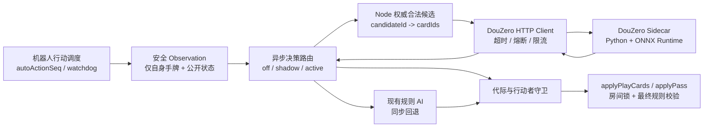
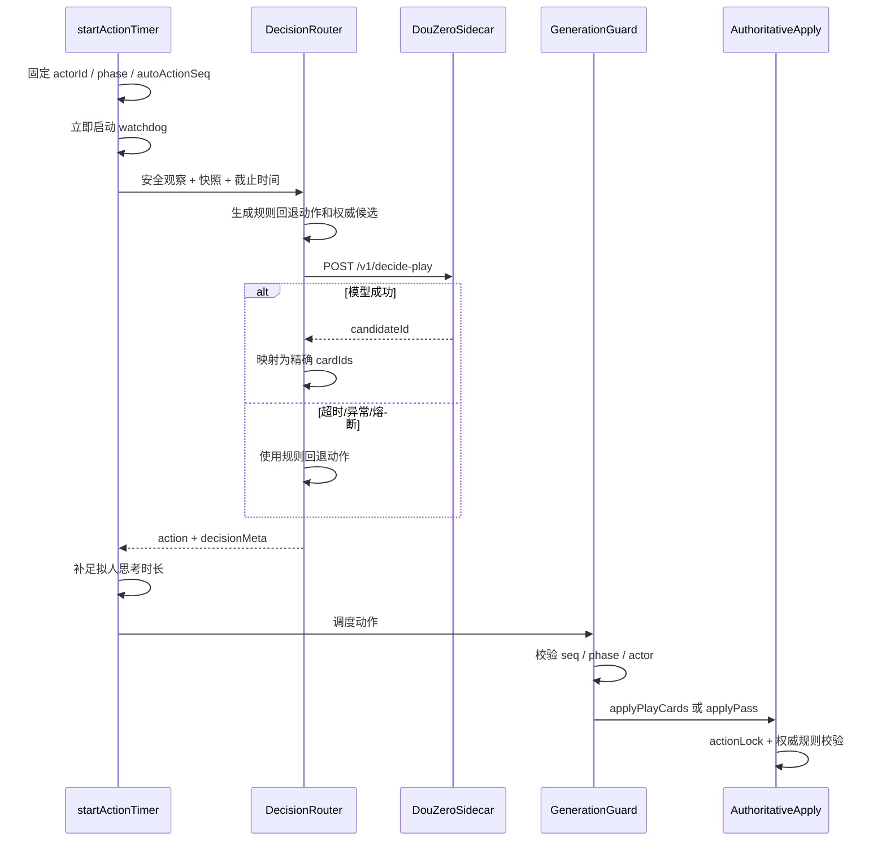

# DouZero 出牌模型接入设计方案

> 文档状态：已实现，真实权重与 active 灰度仍受发布门禁约束  
> 更新时间：2026-09-01  
> 适用范围：当前斗地主服务端的机器人出牌决策  
> 事实基线：Node.js 单活动实例、服务端权威牌局、MySQL-only 持久化

## 1. 结论与关键决策

DouZero 可以接入当前项目，但只接管机器人在 `playing` 阶段的出牌候选评分，不接管叫地主、抢地主、地主加倍、规则裁决、回合推进和资金结算。

本方案采用以下确定性设计：

1. **服务端规则继续是唯一权威**：Node.js 先生成合法候选，DouZero 只能从候选中选择；模型不能构造候选，也不能绕过 `analyzePlay`、`canBeat` 和 `removeCards`。
2. **模型作为同机私网 Sidecar**：Python + ONNX Runtime 独立进程提供无状态 HTTP 推理，Node.js 不直接加载 Python 或 ONNX。
3. **只使用经审核的来源**：不复制 `fight-the-landlord-main` 的 GPL-3.0 包装代码；基于 Apache-2.0 的官方 DouZero 源码重新实现最小推理服务，具体 ONNX 权重须在接入前单独完成来源与许可证审核。
4. **补齐内存出牌历史**：每局在房间内保存出牌和过牌序列，实时构建 DouZero 所需上下文，不在机器人行动时回查 MySQL。
5. **异步调用、失败开放**：模型超时、不可用、返回未知候选或熔断时，立即回退现有规则 AI；DouZero 不作为游戏服务就绪条件。
6. **按整局灰度**：一个对局内所有机器人固定使用同一决策引擎，避免中途切换策略并保持 `bot_strategy_version` 可审计。
7. **首期采用 WP 模型**：以胜率为目标，不让模型直接优化铁豆收益或倍率；Persona 首期仅继续影响叫抢、加倍和思考时长。

## 2. 目标与非目标

### 2.1 目标

- 提升机器人残局、农民配合和复杂牌型下的出牌质量。
- 保持客户端协议、牌局状态机和经济系统不变。
- 模型故障时不影响牌局完成，不产生非法出牌或房间卡死。
- 能按模型版本、角色和场次观测效果，并支持影子验证与快速回退。
- 为以后替换权重或增加其他决策引擎保留薄适配接口。

### 2.2 非目标

- 不使用 DouZero 决定叫地主、抢地主或地主加倍。
- 不修改现有牌型和倍率规则来迎合模型。
- 不把模型或推理接口暴露给小游戏客户端。
- 不把其他玩家的真实手牌发送给模型。
- 首期不训练、微调模型，不启用 Persona 的模型分数扰动。
- 首期不解决多活动游戏实例和进行中房间跨实例恢复。

## 3. 当前基础与差距

### 3.1 已具备的接入基础

| 能力 | 当前实现 | 接入判断 |
|---|---|---|
| 统一观察 | `server/game-ai/observation.js` | 可扩展 DouZero 所需公开上下文 |
| 合法动作 | `server/game-ai/legal-actions.js` | 可作为模型候选唯一来源，但需先做穷举一致性验证 |
| 规则策略 | `server/game-ai/strategy.js` | 保留为叫抢、加倍和所有失败场景的回退策略 |
| 机器人调度 | `server/index.js`、`server/bots/bot-scheduler.js` | 已有行动代际 `autoActionSeq`、阶段和行动者守卫 |
| 权威校验 | `server/index.js`、`server/rules.js`、`server/cards.js` | 模型动作最终仍经过同一套校验和房间锁 |
| 审计 | `game_match_events.payload_json` | 可记录模型版本、延迟和回退原因，无需新增表 |
| 策略版本 | `game_matches.bot_strategy_version` | 可记录每局实际引擎和权重版本 |

### 3.2 需要补齐的差距

1. `room` 目前只保留 `lastPlay` 和 `passCount`，缺少完整出牌/过牌序列。
2. `decideAction` 是同步函数，当前机器人调度链不能直接等待 HTTP 推理。
3. 当前合法动作生成器需要与 `rules.js` 及 DouZero 规则做穷举对齐，尤其是飞机带牌、从四张中拆三张、四带二，以及两个四张组成八张组合等边界。
4. 参考推理服务自行生成合法动作，且把 `bomb_num` 固定为 `0`；本方案不沿用这两个行为。
5. `scheduleGuardedAction` 对 `doubling` 阶段读取了 `room.currentPlayerId`，而正确行动者是 `room.doublingPlayerId`。接入时应先统一改用 `currentActionPlayerId(room)`，避免机器人加倍继续依赖 watchdog。

### 3.3 仓库前置门禁

- 当前项目与 `workflow-run.yml` 已统一为 `ks651896049489522351`；部分历史设计文档仍保留迁移前 APPID，仅作历史记录，不作为本次构建配置来源。
- `docs/game-privacy.md`、`docs/idea.md` 与 `docs/server.md` 已补齐并作为实现约束；真实模型仍需完成许可证、来源、权重哈希和外部 manifest 摘要审核。

## 4. 总体架构



职责边界：

| 组件 | 负责 | 不负责 |
|---|---|---|
| Node 牌局内核 | 当前行动者、手牌、合法候选、最终校验、回合推进、审计、降级 | 神经网络推理 |
| DouZero Client | 协议转换、超时、响应校验、熔断、指标 | 牌型裁决、重试出牌 |
| DouZero Sidecar | 特征构建、ONNX 推理、候选评分 | 房间状态、用户身份、资金、候选生成 |
| MySQL | 已有比赛事件与策略版本审计 | 实时推理上下文读取 |
| 客户端 | 无变化 | 直接访问模型、选择机器人动作 |

## 5. 房间状态与 DouZero 上下文

### 5.1 新增内存状态

在房间中增加一个最小字段：

```js
room.playActionHistory = [
  {
    seq: 1,
    playerId: "player-id",
    type: "play",
    ranks: [3, 3],
    playType: "pair"
  },
  {
    seq: 2,
    playerId: "player-id",
    type: "pass",
    ranks: [],
    playType: null
  }
]
```

约束：

- 在 `startRound` 中初始化为空数组，每局重新开始。
- 只在权威规则校验通过后追加，禁止由客户端消息直接写入。
- 当前权威动作沿用“先持久化事件，成功后再提交内存状态”的既有恢复语义：`hands`、`handCounts`、`lastPlay`、`passCount` 与 `playActionHistory` 在同一动作锁内、同一次持久化成功后连续更新；数据库失败时它们均保持原值，可安全重试。
- 若未来改为先提交内存状态或增加数据库失败回滚，`playActionHistory` 必须与该动作涉及的全部房间状态纳入同一份快照，禁止单独回滚或延迟补写。
- `play` 与 `pass` 都占一个连续序号；过牌必须保留为空动作。
- 不复制其他玩家手牌，不保存模型特征矩阵。
- 不新增数据库表；已有 `play_cards`、`pass` 事件继续承担持久审计。
- 当前架构不恢复进程重启前的房间，因此首期不设计历史重放恢复。

### 5.2 相对位置映射

以地主座位为基准：

| 当前座位 | DouZero position |
|---|---|
| `seat === landlordSeat` | `landlord` |
| `seat === (landlordSeat + 1) % 3` | `landlord_down` |
| 其余座位 | `landlord_up` |

这里沿用服务端 `nextPlayerId` 的座位递增方向，禁止按客户端 UI 的左右视觉位置推导。

### 5.3 牌值编码

| 当前项目 rank | 牌面 | DouZero |
|---:|---|---:|
| `3`～`14` | `3`～`A` | `3`～`14` |
| `15` | `2` | `17` |
| `16` | 小王 | `20` |
| `17` | 大王 | `30` |

模型返回的是牌面组合，不包含花色。Node 不直接从手牌随意取牌，而是通过本次请求的 `candidateId` 找回已经生成并校验过的精确 `cardIds`。

### 5.4 上下文字段来源

| DouZero 字段 | Node 来源/计算方式 |
|---|---|
| `position` | 当前机器人座位相对地主座位映射 |
| `hand` | `room.hands[actorId]`，仅当前机器人自己的手牌 |
| `bottom_cards` | `room.landlordCardsVisible`；用于一致性检查、协议兼容和未来特征扩展，当前参考 ONNX 特征不直接消费该字段 |
| `played_cards.*` | 按玩家位置汇总 `playActionHistory` 中所有 `play.ranks` |
| `action_sequence` | 按序映射全部 `play` 和 `pass`；pass 为 `[]` |
| `num_cards_left` | `room.handCounts` 按相对位置映射 |
| `last_move` | `room.lastPlay.cards`；牌墩清空时为 `[]` |
| `last_move_position` | `room.lastPlay.playerId` 的相对位置；无前手时为空 |
| `last_move_by_position` | 从历史计算三个位置各自最近一次动作；该位置最近一次为 pass 时必须是 `[]`，供农民模型的地主/队友最近动作特征使用 |
| `must_play` | `!room.lastPlay || room.lastPlay.playerId === actorId` |
| `bomb_count` | 历史中 `playType` 为 `bomb` 或 `rocket` 的数量，限制在 `0..14` |
| `candidates` | Node 权威合法动作去重、编码后的候选集合 |

构建时必须做以下守恒检查，失败直接使用规则 AI，不调用模型：

- `hand.length === num_cards_left[position]`。
- `sum(num_cards_left) + sum(played_cards) === 54`；自身手牌已包含在 `num_cards_left` 中，不得重复相加。
- 每个牌值在“自身手牌 + 三方已出牌”中的数量不超过整副牌上限。
- `other_hand_cards = full_deck - hand - all_played` 的每项数量非负，且总数等于另外两家的剩余牌数之和。
- `bottom_cards` 是已知底牌的重复视图，不参与上述 54 张总量求和。

## 6. 推理 API 契约

### 6.1 接口

`POST /v1/decide-play`

请求示例：

```json
{
  "schema_version": 1,
  "decision_id": "room-instance:3:42",
  "position": "landlord_down",
  "hand": [3, 3, 3, 3, 5, 6, 7, 7, 8, 9, 10, 11, 12, 13, 14, 17, 20],
  "bottom_cards": [9, 10, 30],
  "played_cards": {
    "landlord": [4, 4, 6, 6],
    "landlord_down": [],
    "landlord_up": [5, 5]
  },
  "action_sequence": [[4, 4], [], [5, 5], [6, 6]],
  "num_cards_left": {
    "landlord": 16,
    "landlord_down": 17,
    "landlord_up": 15
  },
  "last_move": [6, 6],
  "last_move_position": "landlord",
  "last_move_by_position": {
    "landlord": [6, 6],
    "landlord_down": [],
    "landlord_up": [5, 5]
  },
  "must_play": false,
  "bomb_count": 0,
  "candidates": [
    { "id": "a0", "cards": [] },
    { "id": "a1", "cards": [7, 7] },
    { "id": "a2", "cards": [3, 3, 3, 3] }
  ]
}
```

响应示例：

```json
{
  "schema_version": 1,
  "decision_id": "room-instance:3:42",
  "candidate_id": "a1",
  "model": {
    "name": "douzero-wp",
    "version": "2026-09-reviewed",
    "sha256": "<model-manifest-sha256>"
  },
  "inference_ms": 18
}
```

### 6.2 候选规则

- `candidates` 由 Node 生成，Sidecar 直接将其作为 `infoset.legal_actions`，不得再次自行枚举。
- 相同牌面组合只保留一个候选；Node 保留 `candidateId -> {type, cardIds}` 映射。
- 主动出牌时不提供空候选；跟牌时空候选代表 `pass`。
- Sidecar 只能返回请求中存在的 `candidate_id`。
- v1 只执行最高分候选，不返回或消费模型分数；需要风格化选牌时再单独扩展协议。

### 6.3 错误与限制

| 情况 | Sidecar 行为 | Node 行为 |
|---|---|---|
| 请求字段或牌数非法 | `400/422` | 规则 AI 回退，记录 `invalid_request` |
| 模型未加载 | `503` | 规则 AI 回退，计入熔断 |
| 推理内部超时 | `504` | 规则 AI 回退，计入熔断 |
| 未知 `candidate_id` | 视为协议错误 | 丢弃响应并回退，绝不映射手牌 |
| `decision_id` 不一致 | 视为过期/串包 | 丢弃响应并回退 |
| 响应超过 32 KiB | 中止读取 | 回退并记录协议错误 |

单次行动不重试模型。重试会增加尾延迟，且没有必要，因为现有规则 AI 已能完成行动。

## 7. Node 决策与调度流程

### 7.1 决策接口

保留 `strategy.js` 作为同步规则策略，新增异步路由：

```text
resolveBotAction(observation, decisionContext) -> Promise<Action>
```

行为：

- `bidding`：直接调用现有 `decideBid`。
- `doubling`：直接调用现有 `decideDouble`。
- `playing + off`：直接调用现有 `decidePlay`。
- `playing + shadow`：立即按规则动作进入正常调度，同时异步请求 DouZero，只记录聚合差异，不影响牌局。
- `playing + active`：请求 DouZero；任何失败都返回同一快照上计算的规则动作。

`off`、`shadow`、`active` 是互斥运行模式。`shadow` 请求使用同样的 800 ms 超时和独立的最多 2 个并发槽位，不排队；容量不足时直接丢弃影子请求。进入 `active` 后，未命中主动灰度桶的对局仅运行规则 AI，不同时发 shadow 请求，避免观测流量挤占主动推理。

### 7.2 单回合时序



实现约束：

1. watchdog 在发起模型请求前启动，模型调用不能延后超时保护。
2. 模型 HTTP 默认截止时间为 `800 ms`，最大允许配置为 `1500 ms`。
3. 模型耗时计入思考时长；最终等待时间先按 `max(0, targetThinkMs - elapsedMs)` 计算，再裁剪到 `actionDeadlineAt - now - 500 ms` 以内。模型请求与拟人等待共用这个绝对截止时间，不能让 6 秒思考上限越过 5 秒快速响应回合。
4. 响应返回后再次校验 `autoActionSeq`、阶段和行动者，过期响应只记指标，不执行。
5. 最终仍调用 `applyPlayCards` 或 `applyPass`，禁止直接修改 `room.hands`、`lastPlay` 或 `currentPlayerId`。
6. `playing` 自动行动通过一个 `withActionLock` 完成：持锁后再次检查代际、阶段和行动者，重新验证模型候选；无效时改用同一快照预先计算的规则候选，最后只调用一次对应的 unlocked 应用函数。模型候选和规则候选都无效时退出并交给 watchdog，禁止释放锁后再发起第二次独立动作。

### 7.3 熔断策略

- 至少积累 10 次调用后，以最近最多 20 次为窗口统计；窗口未达到 10 次时不因比例打开熔断。
- 窗口内至少出现 5 次失败且失败率达到 50% 时打开熔断器。
- 熔断 30 秒，期间所有行动直接使用规则 AI。
- 半开状态只允许 1 个探测请求；成功关闭，失败继续打开。
- 超时、连接失败、`5xx`、非法 JSON、未知候选均计为失败；业务可接受的模型选择不计失败。
- 熔断状态不影响 Node `/readyz`，只触发机器人模型告警。

## 8. DouZero Sidecar 设计

### 8.1 技术选型

- Runtime：Python 3.11 或 3.12，以目标平台上 ONNX Runtime 的稳定支持版本为准，不采用参考项目声明的 Python 3.14。
- HTTP：FastAPI + Uvicorn，使用严格请求模型和请求体上限。
- 推理：NumPy + ONNX Runtime CPU Provider。
- 模型：`landlord.onnx`、`landlord_down.onnx`、`landlord_up.onnx` 三个位置模型。
- 存储：无数据库、无会话状态、无用户数据落盘。

### 8.2 启动与模型供应链

- 镜像构建和服务启动均不得从 Hugging Face 或其他公网地址自动下载模型。
- 模型进入内部制品库前归档：来源 URL、许可证、原始文件 SHA-256、转换脚本版本、ONNX opset 和验收记录。
- `model-manifest.json` 固化三份权重的 SHA-256；启动时逐一校验，不匹配则拒绝 ready。
- 审核/制品系统另外注入完整 manifest 的 `DOUZERO_APPROVED_MANIFEST_SHA256`；Sidecar 先核对该外部摘要，再信任 manifest 内的审批状态和权重哈希。
- 保留官方 Apache-2.0 LICENSE、NOTICE 和修改说明；GPL-3.0 参考仓库只作为接口研究材料。

### 8.3 服务端点

| 端点 | 语义 |
|---|---|
| `GET /healthz` | Python 进程存活 |
| `GET /readyz` | 三个模型已加载且哈希校验通过 |
| `POST /v1/decide-play` | 对 Node 提供的候选执行评分并返回候选 ID |

Sidecar 仅加入容器内部网络，不发布宿主机公网端口。生产环境由 Node 通过内部服务名访问；如果部署边界不再是同机私网，则必须增加服务间认证和网络访问控制。

### 8.4 并发与资源

- 使用有界并发，初始并发上限设为 `4`，超出后快速返回 `503 busy`，由 Node 回退。
- ONNX Session 在启动时创建并复用，不在请求内重复加载。
- 每个 Session 默认限制为 1 个 intra-op 和 1 个 inter-op 线程，避免三个模型在 2 vCPU 配额下各自扩张线程池；压测后再显式调大。
- 初始按 `1～2 vCPU / 2 GiB` 设置容器限制，最终规格以真实模型压测为准。
- 与 Node 同机部署时必须监控 Node 事件循环延迟；若 Sidecar 导致事件循环或 WebSocket 尾延迟超标，再迁移到独立内网计算实例，协议不变。

## 9. 配置、灰度与回滚

### 9.1 Node 配置

| 环境变量 | 默认值 | 说明 |
|---|---|---|
| `DDZ_DOUZERO_MODE` | `off` | `off`、`shadow`、`active` |
| `DDZ_DOUZERO_URL` | `http://douzero:2021` | Sidecar 内网地址 |
| `DDZ_DOUZERO_TIMEOUT_MS` | `800` | 单次调用超时，最大 `1500` |
| `DDZ_DOUZERO_TRAFFIC_PERCENT` | `0` | active 时按整局灰度，范围 `0..100` |
| `DDZ_DOUZERO_SHADOW_PERCENT` | `0` | shadow 请求比例，范围 `0..100` |
| `DDZ_DOUZERO_MAX_CONCURRENT` | `4` | Node 主流量在途上限；Compose 与 Sidecar 使用同一容量值 |
| `DDZ_DOUZERO_SHADOW_MAX_CONCURRENT` | `2` | shadow 模式独立的可丢弃流量上限 |
| `DDZ_DOUZERO_SHADOW_LOG_EVERY` | `100` | 每 N 个 shadow 结果输出一条脱敏聚合日志 |
| `DDZ_DOUZERO_DECISION_LOG_PERCENT` | `5` | 正常规则动作按整局稳定采样；模型与降级始终记录 |
| `DDZ_DOUZERO_CIRCUIT_WINDOW` | `20` | 熔断滚动窗口 |
| `DDZ_DOUZERO_CIRCUIT_COOLDOWN_MS` | `30000` | 熔断冷却时间 |

灰度桶使用稳定键 `room.instanceId + round.number` 计算。引擎在 `startRound` 时确定并写入房间，整局不变。

### 9.2 策略版本

建议写入 `bot_strategy_version`：

- 规则基线：`rule-v1`
- 影子：`bot-ai-v1+dz-<配置模型版本>-shadow`
- 模型生效：`dz-wp-<sha8>`
- 模型失败回退仍保留该局原策略版本，具体失败写入动作事件 `decisionMeta`。

字符串必须保持在现有 `VARCHAR(64)` 范围内。

### 9.3 发布顺序

1. `off`：只部署状态、协议和假服务测试，线上行为完全不变。
2. `shadow 10%`：规则动作生效，收集模型延迟、候选一致性和选择差异。
3. `shadow 100%`：覆盖三个角色和所有主要牌型，继续不影响玩家。
4. `active 5%`：按整局灰度，与规则控制组比较。
5. `active 25%`：确认稳定性和人机难度后扩大。
6. `active 100%`：保留规则 AI、熔断器和开关，不删除回退链路。

紧急回滚不依赖 Node 重启：停止或隔离 Sidecar 后，Node 在请求失败时即时回退，熔断器随后停止请求。配置层再在下一次安全发布中切回 `off`。

## 10. 审计与可观测性

### 10.1 动作事件

对 `playing` 模型路径，不再在实际应用动作前写入可能失真的 `automatic_decision`；现有 `bidding` 和 `doubling` 审计语义保持不变。将最终决策元数据作为可选参数传入权威应用函数，并随成功的 `play_cards` 或 `pass` 事件一起写入；这样事件里的动作、应用引擎和回退原因一定对应真正生效的动作。模型候选与规则候选都被锁内校验拒绝时不写动作成功日志，随后由 watchdog 接管；watchdog 的最终规则动作按正常成功事件和决策日志记录。

成功动作事件中的 `decisionMeta` 示例：

```json
{
  "requestedEngine": "douzero",
  "selectedEngine": "douzero",
  "fallbackReason": null,
  "fallbackApplied": false,
  "modelName": "douzero-wp",
  "modelVersion": "2026-09-reviewed",
  "modelSha": "<sha256>",
  "decisionId": "room-instance:3:42",
  "candidateCount": 18,
  "inferenceMs": 18,
  "totalDecisionMs": 24,
  "strategyVersion": "dz-wp-<sha8>"
}
```

影子模式不逐动作落库，只在进程内累计并每 100 个样本输出一条聚合日志；它不能增加权威动作前的数据库等待。`[机器人决策]` 使用受控枚举的 `requested_engine` 与 `selected_engine`：可区分普通规则、Shadow 规则落地、模型生效和主动路径降级，但不记录完整手牌、其他玩家身份、请求体、模型特征矩阵和认证信息。现有动作事件已经记录实际 `cardIds`，无需重复记录完整上下文。

### 10.2 指标

- 当前代码直接提供影子窗口样本数、一致/分歧/失败数、平均推理耗时和有限错误原因聚合日志；日志平台可据此形成影子一致率与失败率指标。
- 主动路径通过动作事件中的 `decisionMeta` 统计请求引擎、实际引擎、延迟及降级原因；`[机器人决策]` 对模型/降级全量记录、对普通规则和正常 Shadow 落地动作稳定采样，控制日志量。
- 后续接入统一指标 SDK 时，再补请求总数、推理延迟分位数、熔断状态和候选数量分布；首期不引入新的监控依赖。
- 按策略版本统计人类胜率、机器人胜率、平均局时、炸弹率、春天率和真人净铁豆变化。

告警基线：

- 5 分钟模型回退率超过 5%。
- 连续出现未知候选或最终非法动作；目标值必须为 0。
- 推理 `p99` 超过 `500 ms` 或达到 Node `800 ms` 截止时间。
- 熔断器持续打开超过一个冷却周期。
- 启用模型后 Node 事件循环延迟、行动超时率或房间异常结束率显著上升。

## 11. 代码落点规划

以下代码落点已经按本设计实现：

```text
server/
├── game-ai/
│   ├── observation.js               # 增加安全公开历史字段
│   ├── legal-actions.js             # 权威候选穷举与牌面去重
│   ├── strategy.js                  # 保留同步规则策略
│   ├── decision-router.js           # off/shadow/active 异步编排
│   ├── action-guard.js              # 锁内无副作用复核与规则即时回退
│   ├── shadow-metrics.js            # 固定窗口、无牌面的影子聚合日志
│   └── douzero/
│       ├── codec.js                 # 牌值、位置、candidateId 映射
│       ├── context-builder.js       # 房间快照 -> v1 请求
│       ├── client.js                # HTTP、超时、响应上限
│       └── circuit-breaker.js       # 进程内熔断
├── bots/
│   └── bot-scheduler.js             # 统一阶段行动者 guard
└── index.js                         # 历史写入、异步调度、审计字段

douzero-service/
├── app.py                           # /healthz /readyz /v1/decide-play
├── inference.py                     # ONNX 推理与模型契约校验
├── features.py                      # 独立实现的 DouZero 兼容特征编码
├── model-manifest.json              # 模型来源和 SHA-256
├── pyproject.toml
├── Dockerfile
└── NOTICE
```

预计不需要修改：

- 小游戏客户端 `package/`。
- WebSocket 上下行协议。
- MySQL schema。
- 钱包、机器人资金池和结算模块。
- 叫地主、抢地主和加倍规则。

## 12. 测试方案

### 12.1 单元测试

1. 牌值编码和反编码覆盖 54 张牌及重复牌。
2. 地主位于三个座位时，相对位置映射全部正确。
3. 出牌、连续过牌和牌墩清空后的 `action_sequence`、`last_move`、`last_move_by_position`、`must_play` 正确；每个位置最近一次 pass 必须保留为空动作。
4. 三方已出牌、剩余牌数、牌数守恒和 `bomb_count` 正确。
5. 请求中不包含其他玩家手牌、`accountId`、WebSocket 或钱包信息。
6. 相同牌面候选去重，`candidateId` 能稳定映射回精确 `cardIds`。
7. 模型成功、超时、断连、`500`、非法 JSON、未知候选和串包全部正确回退。
8. 熔断打开、半开和恢复行为正确。
9. 模型响应晚于 `autoActionSeq` 时绝不执行。
10. `doubling` 调度使用 `doublingPlayerId`，不再只依赖 watchdog。

### 12.2 规则一致性测试

- 以 `rules.js` 为最终真相，对随机合法手牌和前手执行属性测试：所有候选都必须通过 `analyzePlay/canBeat/removeCards`。
- 与官方 DouZero 动作生成器交叉生成牌面集合，逐项归类为“相同”“Node 漏枚举”“产品规则有意不同”。
- 在处理完所有“Node 漏枚举”前，禁止进入 active 灰度；有意差异写成固定回归样例。
- 重点样例：飞机不带、飞机带单、飞机带对、从四张拆三张、四带一对、四带两单、四带两对、两个四张组成的八张组合（DouZero TYPE_14 边界，不等于同时打出两个炸弹）、王炸、首出和两家过牌后的重新领出。

### 12.3 契约与集成测试

- 使用假 Sidecar 跑完整牌局：正常候选、pass、超时、未知候选、服务重启和熔断。
- 使用真实三份 ONNX 权重执行 landlord、landlord_down、landlord_up 金样例。
- 验证模型服务重启期间牌局仍由规则 AI 完成。
- 验证模型服务永远无法通过 Node API读取对手手牌。
- 复跑现有规则、AI、行动锁、完整牌局、机器人结算和资金守恒测试。

### 12.4 性能与灰度验收

技术门槛：

- 模型响应返回请求候选的比例：100%。
- 模型导致的最终非法动作：0。
- 推理 `p95 <= 200 ms`，`p99 <= 500 ms`，超时率 `< 0.1%`。
- 压测容量达到预计峰值的 2 倍，且 Node 事件循环与 WebSocket 延迟不超现有基线。
- Sidecar 不可用时，完整牌局成功率与规则基线一致。

产品与风控门槛：

- 每个 active 阶段至少积累 2,000 局已结算样本，按角色和场次与同期规则控制组比较。
- 人类胜率相对控制组变化不超过 5 个百分点，除非产品明确接受新的难度目标。
- 真人平均净铁豆变化、机器人资金池守恒、异常结算率不得恶化。
- 平均局时、炸弹率和春天率无明显异常漂移。

## 13. 分阶段实施清单

### Phase 0：合规与规则门禁

- 已统一当前目录 APPID 和工作流元数据；历史文档中的旧 APPID 不参与构建。
- 补齐隐私与服务端设计前置文档。
- 确认官方源码、具体权重和 ONNX 转换产物的许可证。
- 固化模型 manifest、SHA-256 和内部制品地址。
- 完成 Node 合法动作穷举一致性测试。

### Phase 1：Node 接入骨架，默认关闭

- 增加 `playActionHistory` 及上下文构造。
- 建立候选 ID 映射、异步决策路由、HTTP Client 和熔断。
- 修正机器人 `doubling` 调度守卫。
- 用假 Sidecar 完成单元和完整牌局测试。
- 生产默认保持 `DDZ_DOUZERO_MODE=off`。

### Phase 2：推理 Sidecar

- 基于审核后的官方 DouZero 实现最小 ONNX 服务。
- 使用 Node 提供的候选，不在 Python 侧重新枚举。
- 接入真实权重、健康检查、模型哈希和容器资源限制。
- 完成三位置金样例、故障注入和并发压测。

### Phase 3：影子验证

- 依次开启 10% 和 100% shadow。
- 规则动作继续生效，核对模型合法性、延迟、选择差异和资源占用。
- 达到技术门槛后才允许 active。

### Phase 4：主动灰度

- 按整局依次开启 5%、25%、100%。
- 每个阶段达到技术、产品和资金风控门槛后再扩大。
- 任一门槛失败时停止 Sidecar或切回 `off`，牌局自动落回规则 AI。

## 14. 风险与处置

| 风险 | 影响 | 处置 |
|---|---|---|
| 复制 GPL-3.0 参考包装 | 商业分发合规风险 | 不复制；从 Apache-2.0 官方源重建并归档 NOTICE |
| 权重来源不清或被替换 | 合规与供应链风险 | 内部制品、许可证归档、SHA-256 启动校验 |
| Node 与模型规则不一致 | 非法动作或策略失真 | Node 提供唯一候选，最终再次权威校验 |
| 出牌历史漏记或乱序 | 模型判断错误 | 单一权威写入点、连续 seq、属性测试 |
| Sidecar CPU 抢占 | WebSocket 和计时器抖动 | 容器限额、有界并发、事件循环监控，必要时拆机 |
| 模型过强或过弱 | 玩家体验和经济波动 | 整局 A/B、分角色指标、灰度门槛和快速回退 |
| Persona 风格被模型抹平 | 机器人同质化 | 首期保留叫抢/加倍/时长差异；后续再评估 top-k 风格层 |
| 模型不可用 | 机器人行动失败 | 800 ms 超时、无重试、规则 AI、watchdog 和熔断 |
| 未来权重输入协议变化 | 适配成本 | `schema_version`、模型 manifest 和独立 codec |

## 15. 最终验收定义

只有同时满足以下条件，DouZero 才算完成接入：

1. 客户端、牌局规则、资金结算和人工玩家操作协议没有变化。
2. 模型只能在 Node 给定的合法候选中选择，未知候选永不执行。
3. 三个相对位置、完整出牌/过牌历史、各位置最近动作和真实炸弹数均正确进入模型。
4. 模型超时、崩溃、重启、非法响应时牌局可无感回退并正常结算。
5. 模型版本、权重哈希、每次实际引擎和回退原因都可审计。
6. 许可证、NOTICE、模型来源和哈希记录完成评审。
7. 影子与主动灰度数据达到本方案的技术、体验和资金风控门槛。
