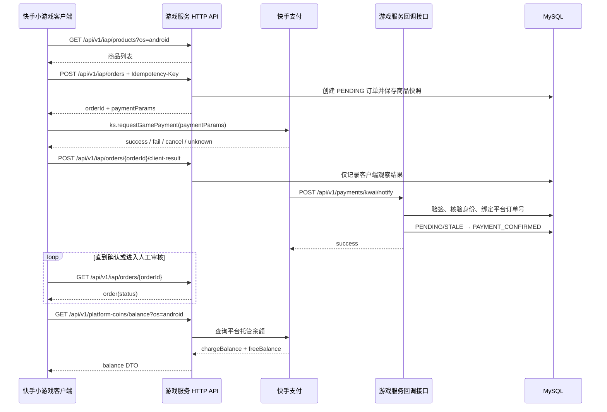
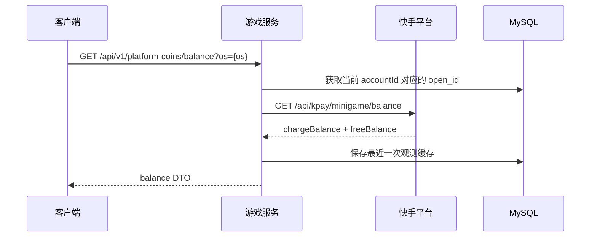
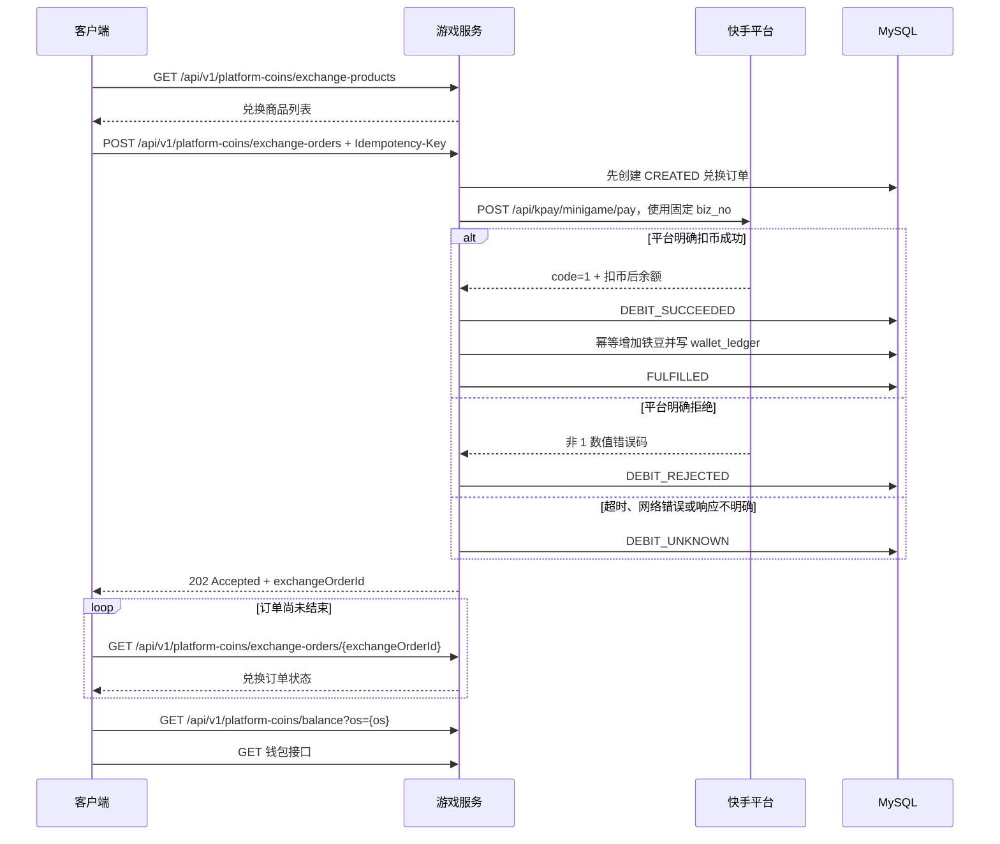

# 斗地主客户端支付调用链路与接口文档

> 文档状态：当前实现
> 更新时间：2026-09-08
> 适用范围：快手小游戏客户端、Node.js 游戏服务、快手平台托管币
>
> 通道约定：客户端支付业务使用 HTTP API；WebSocket 只承载游戏实时状态及迁移期兼容消息。快手支付回调、余额查询和扣币均为服务端 HTTP 集成。

## 1. 文档目标

本项目采用以下资金边界：

- 快手平台托管钻石余额，包括充值余额 `chargeBalance` 和赠送余额 `freeBalance`。
- 游戏服务保存充值订单、平台回调确认结果和兑换履约订单，不维护本地钻石钱包。
- 游戏服务维护铁豆钱包 `wallets` 和铁豆流水 `wallet_ledger`。
- 客户端展示的钻石余额只是平台余额快照，不能作为最终扣款依据。

客户端支付由三条链路组成：

1. **人民币充值钻石**：通过 HTTP 创建游戏订单，调用 `ks.requestGamePayment`，等待快手服务端回调确认，最后通过 HTTP 查单并刷新平台余额。
2. **查询钻石余额**：客户端通过鉴权 HTTP API 请求游戏服务，由游戏服务调用快手平台余额接口。
3. **钻石兑换铁豆**：客户端通过 HTTP 创建兑换订单，游戏服务调用快手扣币接口，扣币成功后幂等增加本地铁豆。

客户端不得：

- 自行生成支付签名；
- 直接调用快手服务端余额或扣币接口；
- 把 `ks.requestGamePayment.success` 视为充值最终成功；
- 使用本地缓存余额决定服务端是否允许扣币；
- 在结果未知时生成新的兑换请求重复扣币。


## 2. 调用链路

### 2.1 充值钻石



关键规则：

- `ks.requestGamePayment.success` 只表示客户端平台调用有成功结果，不代表充值订单已被游戏服务确认。
- 只有 `GET /api/v1/iap/orders/{orderId}` 返回 `PAYMENT_CONFIRMED`，客户端才展示充值完成。
- 充值确认后钻石已经由快手托管，服务端不再向本地钻石钱包发放资产。

### 2.2 查询平台托管钻石余额



`platform_coin_balance_cache` 只是观测缓存，不是权威账本。平台查询失败时，当前接口返回错误，不使用缓存余额冒充实时余额。

### 2.3 钻石兑换铁豆



平台扣币与本地发铁豆不是同一个数据库事务，因此采用 Saga：

- 平台扣币成功但本地发豆失败时，后台任务持续幂等补发铁豆。
- 平台扣币结果未知时，必须使用原 `biz_no` 协调，不能生成新兑换单再次扣币。
- 铁豆入账幂等键固定为 `platform_exchange_credit:<exchangeOrderId>`。


## 3. HTTP 协议约定

### 3.1 身份认证

客户端支付 API 必须携带：

```http
Authorization: Bearer <sessionToken>
```

`sessionToken` 复用游戏认证成功后服务端签发的登录态。服务端从 token 中取得 `accountId` 和 `loginType`，客户端不得提交 `accountId` 或 `open_id`。生产支付只允许 `loginType = kwai`，游客返回 HTTP `403` 和错误码 `GUEST_PAYMENT_FORBIDDEN`。

### 3.2 幂等与响应

创建充值和兑换时必须携带：

```http
Idempotency-Key: <UUID>
```

同一业务意图重试必须复用原值。普通成功返回 `200`；首次创建充值订单返回 `201`，相同幂等键重放返回 `200`；仍在处理的兑换返回 `202`。错误统一返回：

```json
{
  "error": {
    "code": "PAYMENT_UNAVAILABLE",
    "message": "payment unavailable"
  }
}
```

常用状态码：`400` 参数错误、`401` 未认证、`403` 游客禁止支付、`404` 订单或商品不存在、`409` 幂等冲突/未决订单冲突、`429` 限流、`503` 支付能力关闭或平台不可用。所有支付响应均带 `Cache-Control: no-store`。

### 3.3 通道兼容

旧版 WebSocket 支付消息暂时保留服务端兼容，但当前 `M3.Iap` 只通过 `M3.IapHttp` 调用 HTTP API。WebSocket 不再是支付事实通道，后续可选支付状态推送也只能作为触发 HTTP 查单的提示。

### 3.4 金额字段

所有钻石、平台币和铁豆数量均按**十进制字符串**处理：

```json
{
  "platformCoinAmount": "60",
  "chargeBalance": "9007199254740990",
  "freeBalance": "3",
  "balance": "9007199254740993"
}
```

客户端不得先转换为 JavaScript `Number` 再计算，应使用字符串算法或 `BigInt`。用于 JSON 序列化时继续传字符串。


## 4. 充值接口

### 4.1 查询充值商品

```http
GET /api/v1/iap/products?os=android
Authorization: Bearer <sessionToken>
```

响应：

```json
{
  "catalogVersion": 1,
  "items": [
    {
      "skuId": "diamond_60",
      "priceFen": "600",
      "priceText": "¥6",
      "diamonds": "60",
      "goodsName": "60钻石",
      "platforms": ["android", "ios"]
    }
  ]}
```

字段说明：

| 字段 | 类型 | 说明 |
|---|---|---|
| `catalogVersion` | number | 当前协议固定为 `1` |
| `skuId` | string | 服务端商品标识，后续建单只提交该值 |
| `priceFen` | string | 人民币分 |
| `priceText` | string | 服务端按整数分精确格式化的 UI 展示价格，例如 `¥6`、`¥6.05` |
| `diamonds` | string | 购买的平台托管钻石数量；字段名为历史兼容名称 |
| `platforms` | string[] | 当前 SKU 已启用的平台 |

客户端必须使用服务端 Catalog，不得自行提交价格或到账数量。平台托管总开关、充值总开关或当前 OS 售卖开关任一关闭时，接口返回空 `items`，避免客户端展示不可购买商品。

### 4.2 创建充值订单

```http
POST /api/v1/iap/orders
Authorization: Bearer <sessionToken>
Idempotency-Key: 21ed35a0-30d6-4f9c-a887-8602e4eb622f
Content-Type: application/json
```

```json
{
  "skuId": "diamond_60",
  "os": "android"
}
```

`Idempotency-Key` 是同一购买意图永久复用的 UUID。`skuId` 必须来自商品接口，`os` 只能是 `android` 或 `ios`。首次新建订单返回 HTTP `201`；命中相同账号、幂等键和请求指纹的已有订单时返回 HTTP `200`，响应体仍返回原订单：

```json
{
  "orderId": "iap_1788791000000_a1b2c3d4e5f6",
  "status": "PENDING",
  "platformCoinAmount": "60",
  "paymentParams": {
    "zone_id": "ddz1_0123456789abcdef01234567",
    "os": "android",
    "currency_type": "CNY",
    "buy_quantity": "60",
    "third_party_trade_no": "iap_1788791000000_a1b2c3d4e5f6",
    "goods_category": "平台配置值",
    "goods_name": "60钻石",
    "sign": "服务端签名"
  }}
```

iOS 响应额外包含：

```json
{
  "product_type": 1
}
```

客户端收到响应后，必须把 `paymentParams` 原样传给 `ks.requestGamePayment`。不得修改 `zone_id`、`buy_quantity`、`third_party_trade_no` 或 `sign`。

### 4.3 调用快手支付 `ks.requestGamePayment`

```javascript
ks.requestGamePayment({
  ...paymentParams,
  success(res) {
    // 只表示客户端平台调用返回成功，继续上报并查单。
  },
  fail(err) {
    // 区分用户取消和平台失败，但仍允许后续查单恢复。
  },
  complete(res) {
    // 没有明确结果时按 unknown 处理。
  }
});
```

客户端适配层只透传以下字段：

```text
zone_id
os
currency_type
buy_quantity
third_party_trade_no
extension
product_type
goods_category
goods_name
sign
```

支付调用等待平台回调的 watchdog 为 120 秒。超时只表示客户端没有拿到明确结果，不能认定支付失败。

### 4.4 上报客户端观察结果

```http
POST /api/v1/iap/orders/{orderId}/client-result
Authorization: Bearer <sessionToken>
Content-Type: application/json
```

```json
{
  "code": "SUCCESS",
  "message": "平台返回信息"
}
```

`code` 建议取值：

| 客户端结果 | `code` |
|---|---|
| 平台 success | `SUCCESS` |
| 用户取消 | `USER_CANCELLED` |
| 平台明确失败 | `PLATFORM_FAIL` |
| 超时或无法判断 | `UNKNOWN` |

响应：`iapClientResultRecorded`

```json
{
  "orderId": "iap_1788791000000_a1b2c3d4e5f6"}
```

该接口只记录客户端观察结果，**不确认充值到账，也不改变支付订单状态**。

### 4.5 查询充值订单

```http
GET /api/v1/iap/orders/{orderId}
Authorization: Bearer <sessionToken>
```

响应：

```json
{
  "orderId": "iap_1788791000000_a1b2c3d4e5f6",
  "skuId": "diamond_60",
  "status": "PAYMENT_CONFIRMED",
  "purchasedCoins": "60",
  "createdAt": 1788791000000,
  "paymentConfirmedAt": 1788791012000}
```

订单状态：

| 状态 | 含义 | 客户端处理 |
|---|---|---|
| `PENDING` | 已建单，等待平台通知 | 继续轮询 |
| `STALE` | 等待时间较长，但晚到回调仍可确认 | 降低轮询频率，继续恢复 |
| `PAYMENT_CONFIRMED` | 服务端已验证平台回调 | 显示充值成功并刷新余额 |
| `REVIEW` | 身份、平台单号等存在冲突 | 提示审核中，禁止重复购买同一意图 |

### 4.6 查询待恢复订单

```http
GET /api/v1/iap/orders?status=pending
Authorization: Bearer <sessionToken>
```

响应：

```json
{
  "orders": [
    {
      "orderId": "iap_1788791000000_a1b2c3d4e5f6",
      "skuId": "diamond_60",
      "status": "PENDING",
      "purchasedCoins": "60",
      "createdAt": 1788791000000,
      "updatedAt": 1788791000000
    }
  ]}
```

服务端只返回当前账号的 `PENDING`、`STALE`、`REVIEW` 订单。客户端应在以下时机调用：

- 收到 `authOk` 后；
- 小游戏回到前台时；
- 用户点击“刷新订单”时；
- 本地存在未完成订单记录时。


## 5. 平台币余额接口

### 5.1 查询余额

```http
GET /api/v1/platform-coins/balance?os=android
Authorization: Bearer <sessionToken>
```

响应：

```json
{
  "accountId": "ks_xxxxxxxxxxxxxxxxxxxxxxxxxxxxxxxx",
  "chargeBalance": "60",
  "freeBalance": "10",
  "balance": "70",
  "observedAt": 1788791015000,
  "stale": false}
```

| 字段 | 类型 | 说明 |
|---|---|---|
| `chargeBalance` | string | 充值获得的平台币余额 |
| `freeBalance` | string | 平台赠送币余额 |
| `balance` | string | 两者之和 |
| `observedAt` | number | 服务端取得该快照的毫秒时间戳 |
| `stale` | boolean | 当前实现实时查询成功时固定为 `false` |

客户端应用余额时必须同时校验：

1. `accountId` 与当前登录账号一致；
2. 响应属于当前账号 epoch；
3. `observedAt` 大于已应用快照；
4. `chargeBalance + freeBalance = balance`。

余额查询失败时保留旧 UI 快照并标记过期，不得使用旧余额作为服务端扣币依据。


## 6. 平台币兑换铁豆接口

### 6.1 查询兑换商品

```http
GET /api/v1/platform-coins/exchange-products
Authorization: Bearer <sessionToken>
```

响应：

```json
{
  "catalogVersion": 1,
  "items": [
    {
      "exchangeSkuId": "diamond_to_beans_60",
      "displayName": "60钻石换铁豆",
      "costBalance": "60",
      "grantBeans": "60000",
      "displayOrder": 2
    }
  ]}
```

客户端只提交 `exchangeSkuId`，扣钻数量和发豆数量均以服务端商品快照为准。

### 6.2 创建兑换订单

```http
POST /api/v1/platform-coins/exchange-orders
Authorization: Bearer <sessionToken>
Idempotency-Key: <clientRequestId>
Content-Type: application/json
```

```json
{
  "exchangeSkuId": "diamond_to_beans_60",
  "os": "android"
}
```

同一兑换意图永久复用原 `Idempotency-Key`。响应为 HTTP `200` 或 `202`：

```json
{
  "exchangeOrderId": "pex_0123456789abcdef0123456789abcdef",
  "status": "FULFILLED",
  "spentBalance": "60",
  "grantedBeans": "60000",
  "beansBalanceAfter": "80000",
  "idempotent": false}
```

注意：该响应名称表示服务端已受理，不保证一定已完成。客户端必须根据 `status` 判断，不能仅根据响应类型展示成功。

### 6.3 查询兑换订单

```http
GET /api/v1/platform-coins/exchange-orders/{exchangeOrderId}
Authorization: Bearer <sessionToken>
```

未完成状态返回 HTTP `202`，`FULFILLED` 返回 HTTP `200`：

```json
{
  "exchangeOrderId": "pex_0123456789abcdef0123456789abcdef",
  "status": "DEBIT_UNKNOWN",
  "spentBalance": "0",
  "grantedBeans": "0",
  "beansBalanceAfter": null,
  "idempotent": true}
```

兑换状态：

| 状态 | 含义 | 客户端处理 |
|---|---|---|
| `CREATED` | 本地兑换单已创建 | 轮询原订单 |
| `DEBITING` | 正在请求平台扣币 | 轮询原订单 |
| `DEBIT_UNKNOWN` | 平台结果暂时不明确 | 提示“扣款结果确认中”，轮询原订单 |
| `DEBIT_REJECTED` | 平台明确拒绝扣币 | 显示失败，允许用户重新发起新意图 |
| `DEBIT_SUCCEEDED` | 平台扣币已确认，等待发铁豆 | 继续轮询，不得再次兑换 |
| `FULFILLING` | 正在幂等增加铁豆 | 继续轮询 |
| `FULFILLED` | 扣币和铁豆履约均完成 | 显示成功，刷新钻石与铁豆余额 |
| `REVIEW` | 超过协调窗口仍无法确认 | 提示人工审核，禁止重复操作 |

只有 `FULFILLED` 响应中的 `spentBalance` 和 `grantedBeans` 才返回实际数量；其他状态当前返回 `"0"`。

### 6.4 兑换幂等规则

- `clientRequestId` 是客户端业务幂等键。
- 服务端使用 `accountId + clientRequestId` 稳定派生 `exchangeOrderId` 和快手 `biz_no`。
- 同一 `clientRequestId` 携带不同 `exchangeSkuId` 或 `os`，返回 `IDEMPOTENCY_KEY_REUSED`。
- `DEBIT_UNKNOWN` 时只查询或恢复原订单，不创建新 `clientRequestId`。
- 相同账号、相同兑换 SKU 已有未决订单时，返回 `EXCHANGE_PENDING`；错误对象额外包含安全的 `exchangeOrderId`，客户端必须持久化该值并查询原订单，不得改用新幂等键重试。

示例：

```json
{
  "error": {
    "code": "EXCHANGE_PENDING",
    "message": "exchange confirmation pending",
    "exchangeOrderId": "pex_0123456789abcdef0123456789abcdef"
  }
}
```

## 7. 状态机与客户端处理

### 7.1 客户端充值 UI 状态

```text
IDLE
  → CATALOG_LOADING
  → READY
  → CREATING_ORDER
  → REQUESTING_PAYMENT
  → CONFIRMING_RESULT
  → FULFILLED
```

可能进入的异常状态：

```text
USER_CANCELLED
PAYMENT_FAILED
CONFIRM_TIMEOUT
REVIEW_REQUIRED
PENDING_LIMIT
SERVICE_ERROR
```

处理原则：

- `USER_CANCELLED` 和 `PAYMENT_FAILED` 仍保留订单恢复记录，因为客户端结果可能与服务端最终回调存在时间差。
- `CONFIRM_TIMEOUT` 只结束当前页面等待，不删除订单；下次启动或回到前台继续恢复。
- 客户端最多保留 3 笔未决充值订单，达到上限后禁止继续建单。
- 建单失败重试必须复用原 `requestId`。

### 7.2 服务端充值状态机

```text
PENDING
  ├─ 超过 TTL → STALE
  ├─ 合法平台回调 → PAYMENT_CONFIRMED
  └─ 身份、extension、平台订单号冲突 → REVIEW

STALE
  ├─ 晚到合法回调 → PAYMENT_CONFIRMED
  └─ 安全冲突 → REVIEW
```

`PAYMENT_CONFIRMED` 和 `REVIEW` 均不得由客户端上报直接触发。

### 7.3 客户端轮询

充值订单：

- 普通订单约每 3 秒查询一次；
- `STALE` 订单约每 11 秒查询一次；
- 当前前台确认等待超过 30 秒进入 `CONFIRM_TIMEOUT`；
- 本地恢复记录保存 7 天；
- 服务端恢复列表最多合并 20 笔。

兑换订单：

- 普通处理中状态约每 2 秒查询一次；
- `DEBIT_UNKNOWN` 约每 5 秒查询一次；
- 创建兑换 10 秒没有收到受理结果时进入 `RETRY_REQUIRED`；
- 已取得 `exchangeOrderId` 后，重试按钮只能查询原订单。

### 7.4 服务端恢复

- 平台请求默认超时 5 秒。
- 新兑换默认立即尝试 2 次，均使用相同 `biz_no`。
- `DEBIT_UNKNOWN` 默认 5 秒后允许恢复。
- `DEBITING` 30 秒租约过期后允许其他实例接管。
- 后台每 5 秒扫描最多 20 笔可恢复兑换订单。
- 48 小时仍不能确认的平台扣币订单进入 `REVIEW`。


## 8. 错误码与重试策略

### 8.1 通用错误

| 错误码 | 含义 | 客户端建议 |
|---|---|---|
| `UNAUTHENTICATED` | 登录态无效 | 重新登录，不重放支付动作 |
| `GUEST_PAYMENT_FORBIDDEN` | 游客禁止支付 | 引导快手登录 |
| `INVALID_CORRELATION_ID` | 请求关联 ID 不合法 | 客户端修复，不自动重试 |
| `INVALID_REQUEST_ID` | 业务幂等 UUID 不合法 | 客户端修复，不自动重试 |
| `INVALID_PLATFORM` | `os` 非 android/ios | 重新识别平台 |
| `RATE_LIMITED` | 当前连接请求过快 | 延迟后重试查询 |
| `ACCOUNT_RATE_LIMITED` | 当前账号请求过快 | 延迟后重试 |
| `PAYMENT_UNAVAILABLE` | 支付配置或平台不可用 | 展示稍后重试 |
| `PAYMENT_DISABLED` | 当前平台、充值或兑换关闭 | 隐藏入口或提示维护中 |

### 8.2 商品与订单错误

| 错误码 | 含义 | 客户端建议 |
|---|---|---|
| `SKU_NOT_FOUND` | 商品不存在 | 刷新 Catalog |
| `SKU_DISABLED` | 商品已下架 | 刷新 Catalog |
| `SKU_INVALID` | 兑换商品配置不合法 | 停止重试并上报 |
| `ORDER_NOT_FOUND` | 当前账号无该订单 | 不展示其他账号信息；清理无效本地记录 |
| `TOO_MANY_PENDING_ORDERS` | 待确认充值订单过多 | 先恢复已有订单 |
| `EXCHANGE_PENDING` | 同 SKU 已有未决兑换 | 查询原兑换订单 |
| `IDEMPOTENCY_KEY_REUSED` | 幂等键被用于不同参数 | 停止操作并记录异常 |

### 8.3 平台调用错误

| 错误码 | 是否可能已扣款 | 客户端建议 |
|---|---:|---|
| `PLATFORM_TIMEOUT` | 是 | 查询原订单，不新建兑换 |
| `PLATFORM_NETWORK_ERROR` | 是 | 查询原订单，不新建兑换 |
| `PLATFORM_INVALID_RESPONSE` | 是 | 查询原订单并告警 |
| `PLATFORM_HTTP_ERROR` | 视状态而定 | 由服务端协调，客户端查原订单 |
| 平台返回的数值错误码 | 通常为明确拒绝 | 展示平台失败原因或通用失败 |

### 8.4 客户端支付适配错误

| 错误码 | 含义 |
|---|---|
| `PAYMENT_API_UNAVAILABLE` | 当前环境没有 `ks.requestGamePayment` |
| `USER_CANCELLED` | 用户取消 |
| `PLATFORM_FAIL` | 平台客户端明确失败 |
| `PAYMENT_CALLBACK_TIMEOUT` | 120 秒没有收到明确回调 |
| `PAYMENT_COMPLETE_UNKNOWN` | `complete` 未包含可判断结果 |
| `PAYMENT_EXCEPTION` | 调用支付 API 时抛异常 |

无论客户端返回 `success`、`fail`、`cancel` 还是 `unknown`，只要服务端已经创建订单，都应允许后续通过 `GET /api/v1/iap/orders/{orderId}` 恢复最终状态。


## 9. 客户端接入示例

以下是独立接入方可参考的伪代码；当前项目已经由 `M3.Iap` 封装同等逻辑。

### 9.1 HTTP 请求封装

```javascript
async function request(path, options = {}) {
  const response = await fetch(API_BASE + path, {
    method: options.method || 'GET',
    headers: {
      Authorization: `Bearer ${sessionToken}`,
      ...(options.body ? { 'Content-Type': 'application/json' } : {}),
      ...(options.idempotencyKey ? { 'Idempotency-Key': options.idempotencyKey } : {})
    },
    body: options.body ? JSON.stringify(options.body) : undefined
  });
  const data = await response.json();
  if (!response.ok) throw data.error;
  return data;
}
```

### 9.2 充值调用

```javascript
async function buyPlatformCoins(skuId) {
  const os = KwaiPayment.getPlatform();
  const requestId = crypto.randomUUID();

  // 先持久化 requestId，确保建单超时后仍可复用原意图。
  savePendingIntent({ requestId, skuId, os });

  const order = await request('/api/v1/iap/orders', {
    method: 'POST',
    idempotencyKey: requestId,
    body: { skuId, os }
  });

  savePendingIntent({
    requestId,
    orderId: order.orderId,
    skuId,
    os
  });

  const result = await KwaiPayment.requestPayment(order.paymentParams);

  await request(`/api/v1/iap/orders/${order.orderId}/client-result`, {
    method: 'POST',
    body: {
      code: result.outcome === 'success'
      ? 'SUCCESS'
      : result.outcome === 'cancel'
        ? 'USER_CANCELLED'
        : result.outcome === 'fail'
          ? 'PLATFORM_FAIL'
          : 'UNKNOWN',
      message: result.message || ''
    }
  });

  return waitForPaymentConfirmed(order.orderId);
}

async function waitForPaymentConfirmed(orderId) {
  for (;;) {
    const order = await request(`/api/v1/iap/orders/${orderId}`);
    if (order.status === 'PAYMENT_CONFIRMED') {
      const balance = await request(`/api/v1/platform-coins/balance?os=${KwaiPayment.getPlatform()}`);
      removePendingIntent(orderId);
      return { order, balance };
    }
    if (order.status === 'REVIEW') {
      throw new Error('ORDER_REVIEW_REQUIRED');
    }
    await delay(order.status === 'STALE' ? 11000 : 3000);
  }
}
```

### 9.3 兑换调用

```javascript
async function exchangeCoins(exchangeSkuId) {
  const clientRequestId = crypto.randomUUID();
  const os = KwaiPayment.getPlatform();

  saveExchangeIntent({ clientRequestId, exchangeSkuId, os });

  const accepted = await request('/api/v1/platform-coins/exchange-orders', {
    method: 'POST',
    idempotencyKey: clientRequestId,
    body: { exchangeSkuId, os }
  });

  saveExchangeIntent({
    clientRequestId,
    exchangeOrderId: accepted.exchangeOrderId,
    exchangeSkuId,
    os
  });

  return waitForExchange(accepted.exchangeOrderId);
}

async function waitForExchange(exchangeOrderId) {
  for (;;) {
    const order = await request(`/api/v1/platform-coins/exchange-orders/${exchangeOrderId}`);

    if (order.status === 'FULFILLED') {
      clearExchangeIntent();
      await Promise.all([
        request(`/api/v1/platform-coins/balance?os=${KwaiPayment.getPlatform()}`),
        request('/api/v1/wallet')
      ]);
      return order;
    }

    if (order.status === 'DEBIT_REJECTED') {
      clearExchangeIntent();
      throw new Error('DEBIT_REJECTED');
    }

    if (order.status === 'REVIEW') {
      throw new Error('REVIEW_REQUIRED');
    }

    await delay(order.status === 'DEBIT_UNKNOWN' ? 5000 : 2000);
  }
}
```

示例省略了账号 epoch、前后台切换、请求超时和 UI 状态处理；生产客户端必须保留这些保护。


## 10. 联调与验收清单

### 10.1 客户端

- [ ] 仅在 `authOk.loginType = kwai` 时开放充值和兑换。
- [ ] 从 `ks.getSystemInfoSync()` 正确识别 `android` 或 `ios`。
- [ ] 所有支付 HTTP 请求携带有效 `Authorization: Bearer <sessionToken>`。
- [ ] 创建充值和兑换时使用 `Idempotency-Key`，同一意图重试复用原值。
- [ ] 兑换恢复复用原 `clientRequestId` 和 `exchangeOrderId`。
- [ ] `ks.requestGamePayment.success` 后继续等待 `PAYMENT_CONFIRMED`。
- [ ] 支付取消、失败和超时后仍可恢复服务端订单。
- [ ] 回到前台时恢复未完成充值和兑换。
- [ ] 账号切换后清空旧账号内存态，旧回包不得污染新账号。
- [ ] 数量字段全程按十进制字符串处理。
- [ ] `FULFILLED` 后同时刷新平台钻石余额和本地铁豆钱包。

### 10.2 服务端

- [ ] 支付签名密钥和回调验签密钥已通过 Secret 注入。
- [ ] 快手 `open_id` 与内部 `accountId` 绑定已持久化。
- [ ] 支付回调公网 HTTPS 地址配置正确。
- [ ] 回调重复投递保持幂等。
- [ ] 平台余额查询不回退到本地钻石账本。
- [ ] 平台扣币超时进入 `DEBIT_UNKNOWN`，不视为失败。
- [ ] 后台兑换恢复任务正常运行。
- [ ] 铁豆入账使用唯一幂等键。

### 10.3 必测故障场景

- [ ] 支付 API 返回成功，但平台回调延迟。
- [ ] 客户端取消后，平台最终仍产生成功回调。
- [ ] 客户端支付过程中切后台、断网或杀进程。
- [ ] 支付回调重复到达。
- [ ] 同一 `requestId` 重复建单。
- [ ] 平台扣币成功后服务进程立即退出。
- [ ] 平台扣币实际成功，但游戏服务请求超时。
- [ ] 同一兑换订单由多个实例并发恢复。
- [ ] 铁豆已入账，但订单终态写入发生重试。
- [ ] 用户切换账号后收到旧账号支付回包。

## 11. 当前实现位置

| 模块 | 文件 |
|---|---|
| 客户端支付 HTTP 适配 | `package/js/iap-http.js` |
| 客户端支付状态机 | `package/js/iap.js` |
| 快手客户端支付适配 | `package/api/kwai-payment.js` |
| 客户端平台余额快照 | `package/js/diamond-wallet.js` |
| 充值商城 UI | `package/js/scene-diamond-store.js` |
| 兑换 UI | `package/js/scene-diamond-exchange.js` |
| 支付 HTTP 路由 | `server/payment/http-api.js`、`server/http-server.js` |
| 旧 WebSocket 支付兼容入口 | `server/index.js` |
| 充值订单服务 | `server/payment/order-service.js` |
| 支付回调 | `server/payment/notify-handler.js` |
| 平台余额服务 | `server/payment/platform-balance-service.js` |
| 快手服务端 API 客户端 | `server/payment/platform-client.js` |
| 平台兑换服务 | `server/payment/platform-exchange-service.js` |
| 平台兑换订单存储 | `server/payment/platform-exchange-store.js` |
| 支付订单存储 | `server/persistence/iap-order-store.js` |
| 平台托管迁移 | `server/scripts/migrations/20260907_platform_managed_iap.sql` |

## 12. 已知约束

- 当前字段 `diamonds`、数据库字段 `grant_diamonds` 是历史兼容命名，实际语义已是快手平台托管币数量。
- 平台币扣减顺序固定为 `pay_priority = 1`，即赠送币优先。
- 当前客户端 `REVIEW` 订单在没有其他可轮询订单时，可能需要前台恢复或手动刷新才能再次查询；不影响服务端最终状态，但客户端后续应补充定时唤醒。
- H5 浏览器环境不具备真实 `ks.requestGamePayment`；真实充值必须在快手小游戏环境联调。

