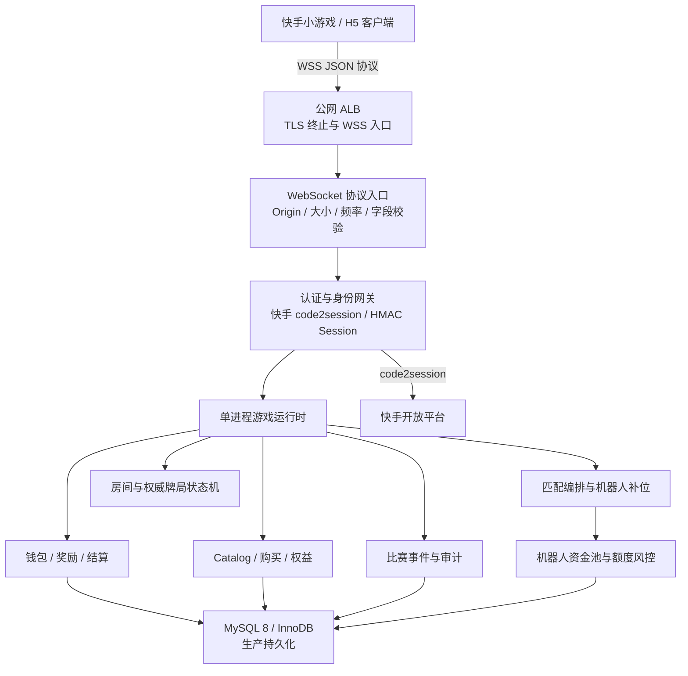
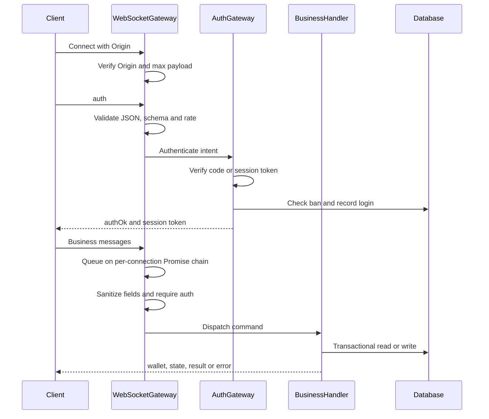
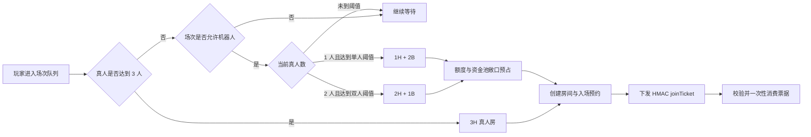
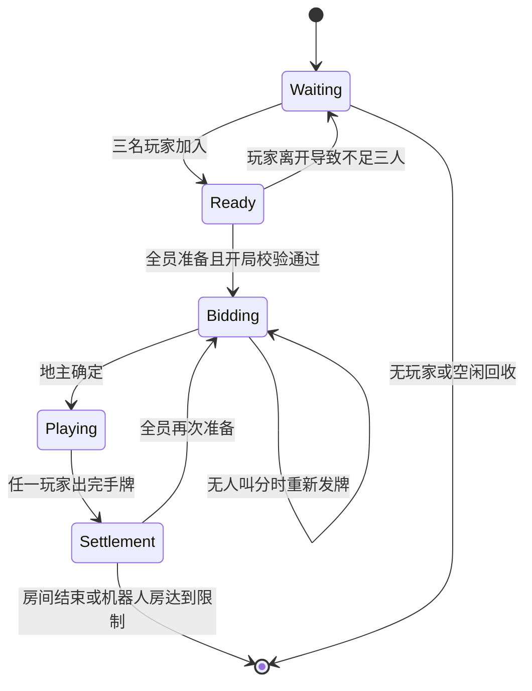
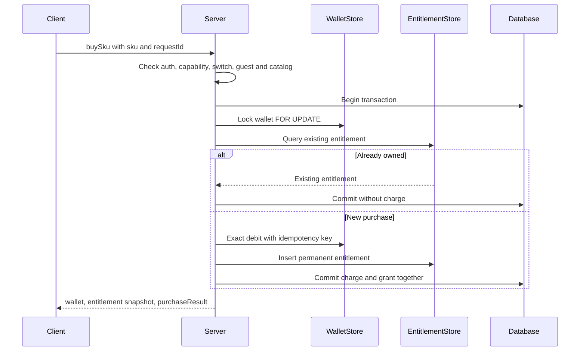
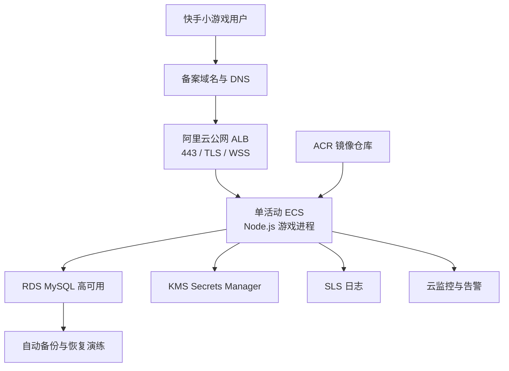

# 老铁斗地主服务端整体技术方案

> 文档定位：以当前仓库代码为事实源，描述已落地服务端能力、运行边界、生产部署方案与后续演进路线。  
> 适用项目：`games/ks699465320497476962`  
> 当前基线：Node.js 单活动实例、WebSocket 长连接、服务端权威牌局、MySQL-only 持久化（本地、测试、预发、正式均使用 MySQL）。

## 1. 方案摘要

服务端采用“**单进程权威游戏内核 + WebSocket 协议网关 + 事务型业务存储**”架构：

- 客户端只提交操作意图，发牌、规则校验、行动顺序、倍率、托管、结算均由服务端决定。
- 每条 WebSocket 连接先完成认证，再进入业务协议；同连接消息串行处理，跨连接并发执行。
- 房间、匹配队列、连接、计时器和机器人调度保存在进程内；钱包、权益、奖励、比赛审计和机器人风控数据持久化到数据库。
- 正式身份由快手 `code2session` 建立，服务端通过 HMAC 派生稳定 `accountId` 并签发无状态 session token；客户端上报的身份字段不可信且会被移除。
- 钱包以账本、幂等键、事务和 MySQL 行锁保证资金正确性；SKU 购买将扣款和权益发放放在同一事务。
- 当前架构只能安全运行一个活动游戏进程。要实现双活动或水平扩容，必须先外置房间、匹配、连接路由、计时器和限流状态。

## 2. 总体架构

### 2.1 模块职责

| 层次 | 主要模块 | 职责 |
|---|---|---|
| 接入层 | `server/index.js` | WebSocket 生命周期、协议白名单、参数清洗、限流、消息路由、响应广播 |
| 身份层 | `server/auth.js`、`server/config/kwai-app.js` | 快手登录、游客登录策略、账号派生、session token、Origin 白名单、新账号防刷 |
| 游戏域 | `cards.js`、`rules.js`、`index.js` | 发牌、牌型、压制关系、叫地主、出牌、过牌、倍率、回合推进、托管与结算 |
| 匹配域 | `matchmaking/*` | 按场次排队、账号唯一会话、真人优先、机器人补位、预约与加入票据 |
| 机器人域 | `bots/*`、`game-ai/*` | Persona、安全观察、合法动作、统一策略、思考延迟、Watchdog |
| 经济域 | `persistence/wallet-store.js` | 钱包、冻结、账本、奖励、幂等资金变更 |
| 交易域 | `trade/*`、`entitlement-store.js` | Catalog、SKU 购买、权益发放、重复购买幂等 |
| 审计域 | `match-store.js` | 比赛、参与者、事件序列、结算结果 |
| 风控域 | `bot-stats-store.js`、`treasury-store.js`、`bot-settlement-store.js` | 机器人局数与收益额度、资金池敞口预占、守恒结算 |
| 数据基础层 | `persistence/db.js` | MySQL-only 连接池、事务上下文、InnoDB 行锁、schema 门禁 |

## 3. 运行时与协议模型

### 3.1 WebSocket 请求链路

处理原则：

1. HTTP 升级阶段校验 Origin，并设置 WebSocket 帧上限。
2. 应用层限制消息字节数，只接受协议白名单中的 `type`。
3. 清洗房间号、场次、牌 ID、SKU、请求 ID、能力列表等字段，并删除客户端自报的 `accountId/openId/guestId`。
4. `ping` 与 `auth` 之外的协议必须先认证。
5. 同一连接使用 Promise 链串行消费消息，避免 `auth` 与后续业务请求并发导致身份状态竞态；不同连接仍可并发。
6. 连接级总限流、命令级限流和账号级限流共同生效；语音、购买和权益同步采用软拒绝，不因业务频繁直接关闭连接。

### 3.2 当前上行协议

| 领域 | 协议 |
|---|---|
| 基础 | `ping`、`auth` |
| 钱包与奖励 | `getWallet`、`claimShareReward`、`claimAdReward`、`claimShortcutReward`、`claimBankruptReward` |
| 匹配与房间 | `quickMatch`、`cancelMatch`、`resumeMatch`、`createRoom`、`join`、`leaveRoom`、`setReady` |
| 牌局 | `bid`、`playCards`、`pass`、`syncHand` |
| 互动与交易 | `voiceMsg`、`buySku`、`getEntitlements` |

## 4. 认证与身份可信边界

### 4.1 三种模式

| 模式 | 用途 | 行为 |
|---|---|---|
| `strict` | 正式环境 | 仅接受正式快手身份；缺少认证密钥直接拒绝启动；未配置浏览器 Origin 白名单时拒绝带 Origin 的连接 |
| `mixed` | 预发/灰度 | 快手登录优先，可按配置保留游客路径 |
| `dev` | 本地和自动化测试 | 允许游客；开发脚本显式注入本地密钥 |

未配置认证模式时默认 `strict`，采用 fail-closed，而不是意外开放游客。

### 4.2 身份链路

- 快手身份：服务端消费临时 code，调用 `code2session`，再使用独立身份盐对 `appId + openId` 做 HMAC，生成稳定且不暴露 openId 的 `ks_*` 账号。
- 游客身份：使用服务端密钥对设备 ID 做 HMAC，生成 `guest_*` 账号；游客仅允许初级场，不允许购买付费 SKU。
- 会话：服务端签发 HMAC session token，载荷包含账号、登录类型、设备和过期时间，校验签名时使用定时安全比较。
- 平台 `session_key` 仅保存在进程内，不进入业务表和下行响应。
- 保留命名空间 `bot::`、`system::` 不允许普通钱包接口访问。
- 认证成功后才绑定连接账号；一条连接不能中途换号。

## 5. 匹配、房间与牌局

### 5.1 匹配编排

按 `junior`、`mid`、`master` 三个场次维护独立内存队列，并按账号维护唯一匹配会话。

核心约束：

- 每个场次用 Promise 锁串行执行组房，避免同一排队会话被重复消费。
- 先满足三真人；机器人仅在允许的场次、达到等待阈值且资金/额度预占成功后补位。
- 匹配房不能绕过预约直接加入；加入票据绑定账号、房间和 `matchRequestId`，有有效期且一次性消费。
- 断线后排队会话保留，可通过 `resumeMatch` 恢复；已预约时可重新签发票据。
- 当前队列、会话和预约都在单进程内存，不能由多个实例独立维护。

### 5.2 房间状态机

房间状态、手牌、当前行动者、倒计时、倍率和连接引用均由服务端维护。公开状态只投影白名单字段，每位玩家的手牌只单播给本人。

### 5.3 权威回合与并发控制

- 服务端创建并洗牌，每人发 17 张，保留 3 张地主牌。
- 叫分、出牌、过牌均验证当前阶段、行动者、牌是否属于手牌、牌型是否合法、是否能压过上一手。
- 房间 `actionLock` 串行化玩家动作、超时动作和机器人动作，防止同一回合被重复推进。
- 每次行动使用 `actionSeq` 和计时器保护；超时后进入自动动作。
- 机器人只接收安全 Observation 与合法动作集合，不读取对手完整手牌；策略由统一版本标识并带 Persona 参数。
- 牌局事件写入顺序化事件表，用于审计与问题复盘。

### 5.4 断线与托管

- 对局中断线先保留座位，并启动 30 秒重连宽限。
- 同账号重新加入可恢复座位、手牌和公开状态，并退出托管。
- 宽限结束后执行退出处罚并转为自动托管，牌局继续结算。
- 主动离开进行中牌局时，旧座位保留给托管控制，但立即解除该账号的新会话占用，避免用户无法重新匹配。
- 房间无人、长期空闲或机器人房达到轮次/生命周期限制时回收房间及关联计时器、预约和预占资源。

## 6. 经济系统与一致性

### 6.1 当前经济基线

| 项目 | 当前代码配置 |
|---|---:|
| 新用户铁豆 | 20,000 |
| 每日登录 | 1,000 |
| 每日首次分享 | 2,000 |
| 加桌奖励 | 5,000（生命周期一次） |
| 破产补助 | 3,000（余额低于 5,000，每日一次） |
| 广告奖励 | 每日最多 20 次、总上限 10,000，分档递减 |

场次参数：

| 场次 | 匹配/准备门槛 | 门票 | 底注 | 最大倍率 | 抽水 |
|---|---:|---:|---:|---:|---:|
| 初级场 `junior` | 5,000 | 0 | 100 | 64 | 3% |
| 中级场 `mid` | 40,000 | 80 | 800 | 128 | 4% |
| 大师场 `master` | 320,000 | 640 | 6,400 | 256 | 5% |

当前 `freezeEnabled=false`，冻结相关能力已实现但场次配置尚未启用。

### 6.2 钱包模型

- `beans`：总余额。
- `frozen_beans`：冻结余额。
- `availableBeans = beans - frozenBeans`：可用于购买、匹配和赔付的余额。
- `wallet_ledger`：每一笔新手赠送、奖励、门票、胜负、抽水、冻结和购买都写入流水。
- `idempotency_key` 有唯一约束，是资金幂等的最终真相来源；并发冲突回滚后在新事务中重读既有流水。
- MySQL 通过 `SELECT ... FOR UPDATE` 锁定钱包行；禁止用 SQLite 串行行为替代真实并发验证。

### 6.3 结算规则

- 请求输赢值由底注、叫分、炸弹/火箭、春天等倍率计算，并受场次最大倍率限制。
- 输家实际扣款不超过可用余额，赢家按实际总损失比例分配，避免产生负余额或凭空增发。
- 赢家收益按场次税率扣除抽水。
- 真人房当前按每个账号的独立幂等资金事务落账，之后更新比赛结算记录；发生中途故障时可依赖幂等键重放，但尚不是一个覆盖三方钱包和比赛状态的全局原子事务。
- 机器人房采用更强事务边界：所有真人钱包、机器人资金池、额度统计和比赛状态在同一事务中结算，并验证 `真人净变化 + 机器人资金池变化 + 抽水 = 0`。

> 生产改进建议：将真人房三方钱包、抽水和比赛状态也收敛到单个结算事务，固定账号锁顺序，并加入 MySQL 死锁整事务重试。

## 7. 机器人体系

机器人能力分为四层：

1. **匹配层**：真人优先，满足等待阈值后形成 `1H+2B` 或 `2H+1B` 房。
2. **决策层**：Observation 只包含合法可见信息；Legal Actions 生成候选；Strategy 根据牌型、角色、队友关系和 Persona 决策。
3. **调度层**：模拟思考延迟，使用房间和行动序列 guard，过期任务不得作用于新状态；Watchdog 确保终态动作。
4. **经济风控层**：开局前按最坏赔付预占机器人资金池敞口和真人额度；结算时一次性核销，失败则释放预占。

机器人场还限制单房最多轮数和房间生命周期，且仅在仍有活跃真人时继续下一局。

## 8. 商品、语音与权益

### 8.1 交易模型

Catalog 是商品、价格、类型和上下架状态的唯一来源。客户端不能决定价格。

关键保证：

- 游客禁止购买；客户端需声明 `voice_trade_v1` capability。
- `DDZ_VOICE_TRADE_ENABLED` 是交易总开关，默认关闭；开发脚本默认覆盖为开启，正式环境需显式启用。
- Catalog 与语音内容 SKU 在启动时交叉校验。
- 钱包行先锁定，再检查权益、精确扣款并发放权益。
- 永久权益由账号与 SKU 唯一约束保证重复购买不二次扣费。
- MySQL 死锁只重试完整购买事务，最多 4 次；禁止只重试其中一条资金语句。
- 下行使用权益快照 `seq`，服务端使用 generation 丢弃过期异步结果，防止旧快照覆盖购买后的新权益。

### 8.2 语音消息

语音不是客户端上传任意音频，而是发送受控 `voiceId`：服务端验证语音存在、当前房间状态、冷却时间和 SKU 权益后，广播配置中的文本和资源地址。发送失败采用业务错误软拒绝，不中断牌局连接。

## 9. 数据架构

### 9.1 核心表

| 数据域 | 表 | 用途 |
|---|---|---|
| 账号 | `accounts` | 登录类型、设备摘要、快手身份摘要、IP、封禁状态 |
| 钱包 | `wallets` | 余额、冻结额、累计收支、版本号 |
| 账本 | `wallet_ledger` | 不可变资金流水与幂等键 |
| 奖励 | `reward_claims` | 每日领取次数和累计金额 |
| 权益 | `user_entitlements` | 账号拥有的 SKU、来源、价格和有效期 |
| 比赛 | `game_matches` | 对局状态、参与者摘要、胜负与结算结果 |
| 比赛参与者 | `game_match_participants` | 座位、角色、控制器、Persona |
| 比赛事件 | `game_match_events` | 递增事件序列与业务载荷 |
| 机器人统计 | `bot_match_stats`、`bot_human_pair_stats` | 日局数、净收益、账号对风险 |
| 机器人预占 | `bot_quota_reservations`、`bot_treasury_reservations` | 局前额度和资金池敞口 |

### 9.2 MySQL-only 持久层约束

- 本项目只支持 MySQL / InnoDB；本地、测试、预发和正式环境均不得使用 SQLite。
- `persistence/db.js` 只保留 `mysql2/promise` 连接池；事务内通过 `AsyncLocalStorage` 复用连接，并使用 InnoDB 行锁。
- 启动时校验核心表和关键列，不在应用启动时自动建表；正式 schema 由 DBA 或发布流程先执行 migration。
- SQL 必须使用 MySQL 语法：upsert 使用 `ON DUPLICATE KEY UPDATE`，非负裁剪使用 `GREATEST`，行锁使用 `FOR UPDATE`。
- 禁止新增 `ON CONFLICT`、`INSERT OR IGNORE`、`PRAGMA`、`node:sqlite`、`better-sqlite3`、`DDZ_DB_PATH`、SQLite migration 或双方言分支。
- 数据库变更应采用 expand/contract：先兼容新增结构，再迁移数据，最后清理旧结构。

## 10. 安全与风控

| 风险 | 当前措施 |
|---|---|
| 客户端伪造身份 | 身份只由 auth 结果绑定；上行身份字段被删除 |
| Session 篡改 | HMAC 签名、有效期、定时安全比较 |
| WebSocket 跨站滥用 | HTTP 升级阶段 Origin 白名单 |
| 大包与协议攻击 | 帧上限、应用消息上限、JSON/对象键/数组长度校验、协议白名单 |
| 高频操作 | 连接级、命令级、账号级滑动窗口限流 |
| 刷新账号领新手豆 | IP 维度的新账号创建窗口限制 |
| 游客洗豆 | 仅允许初级场，禁止购买 |
| 资金重复写 | 唯一幂等键、事务、行锁、冲突重读 |
| 非法牌局操作 | 服务端权威手牌、行动人、阶段和规则校验 |
| 机器人资金风险 | 局前敞口预占、最低储备、日额度、守恒校验 |
| 权益绕过 | 服务端 Catalog 和权益校验，客户端不决定价格和所有权 |

## 11. 部署与运维方案

### 11.1 一期生产拓扑

推荐一期坚持**单活动实例**：ALB 提供稳定 WSS 入口和 TLS，ECS 只运行一个活动游戏进程，RDS 承担持久化。可以准备备用 ECS，但不得同时承接流量；切换前需停止旧实例或确认其失效。

### 11.2 当前运行边界

以下状态仍在内存：

- 房间与完整牌局状态；
- WebSocket 连接与账号到连接的绑定；
- 匹配队列、匹配会话、加入预约；
- 行动、断线和机器人计时器；
- 平台 session key；
- 限流桶、权益连接缓存；
- 机器人调度任务。

因此：

- 进程重启会丢失进行中牌局和匹配状态，但数据库保留钱包与审计记录；
- 多实例会产生队列割裂、同账号重复进入、状态广播失配和计时器重复执行；
- 仅靠 ALB sticky session 不能解决状态故障转移。

### 11.3 上线前必须补齐

1. 增加独立 HTTP 管理端口及 `/healthz`、`/readyz`。
2. 完整处理 `SIGTERM`：先进入 draining，停止接收新匹配/房间，再等待或补偿在局玩家，关闭 WebSocket、计时器和数据库池。
3. 增加结构化日志与统一字段：`requestId/connId/accountHash/roomId/matchId/command/code/duration`。
4. 建立核心指标和告警：在线连接、匹配等待、房间数、消息延迟、事件循环延迟、DB 池、死锁、结算失败、资金守恒、机器人敞口。
5. 将密钥迁入 KMS，禁止真实 appSecret、认证密钥和数据库口令进入仓库或镜像。
6. 固化 DBA migration、备份、恢复演练和回滚流程。
7. 增加重启中止牌局补偿/对账任务，并识别长期 `started` 未 `settled` 的比赛。
8. 完成真人房结算原子化，以及 MySQL 死锁整事务重试。
9. 执行 WebSocket 长连接、匹配风暴、重连风暴、三方并发结算和购买并发压测。

## 12. 演进路线

### Phase 1：单实例生产硬化

- ALB + 单活动 ECS + RDS MySQL。
- 补健康检查、优雅停机、draining、日志、指标、KMS 和恢复演练。
- 完成人真房原子结算和异常牌局补偿。
- 目标是在不改变游戏内核的前提下达到可控发布、可观测、可恢复。

### Phase 2：状态外置与多实例

引入 Tair/Redis 或专用协调服务，逐步外置：

1. 账号在线租约与连接路由；
2. 匹配队列、匹配会话和加入预约；
3. 分布式限流；
4. 房间 owner lease、fencing token 和实例心跳；
5. 房间快照/事件恢复与延迟任务；
6. 发布 draining 与房间迁移/恢复。

多实例时建议使用“**房间单写 owner**”模型：一个房间同一时刻只由一个实例推进，Redis lease 带 fencing token 防止旧 owner 在网络分区后继续写。数据库仍承担钱包、权益和审计的最终持久化。

### Phase 3：平台化与混合云

- 接入 IDC CI/CD、ACR、STS 和 mTLS 安全互通。
- 建立自动扩缩容，但扩缩容必须遵循房间 owner 和 draining 协议。
- 建立跨环境配置中心、灰度发布、自动回滚、容量基线和成本治理。

## 13. 测试与质量保障

当前测试覆盖：

- 牌型和规则；
- 行动锁与超时；
- 认证、身份绑定和快手登录；
- 钱包幂等并发；
- 匹配编排与机器人基础；
- 机器人结算与守恒；
- 普通结算；
- SKU 购买的 MySQL 场景；
- 语音客户端状态；
- 完整牌局与身份绑定 E2E。

上线流水线建议按顺序执行：静态检查 → 单元测试 → MySQL 集成测试 → 协议 E2E → migration 验证 → 镜像扫描 → 预发压测 → 灰度 → 指标观察 → 全量。

## 14. 关键技术决策

1. **服务端权威优先于客户端流畅捷径**：客户端可预测展示，但不能决定牌局、余额、权益和身份。
2. **单活动实例是当前正确边界，不是长期目标**：在状态外置前，盲目加实例会降低正确性。
3. **MySQL 是唯一持久化方案**：不能新增 SQLite 兼容层，不能用 SQLite 的串行行为推断 MySQL 并发安全。
4. **唯一约束是幂等最终裁判**：任何先查后写都必须处理并发唯一冲突。
5. **资金和权益必须在一个事务中提交**：不接受“先扣款、后补发”的常态链路。
6. **功能开关采用生产默认关闭**：开发脚本可显式覆盖，正式开启必须与 schema、客户端 capability 和运维准备协同。
7. **规划项必须和现状分开表达**：健康检查、完整 SIGTERM、双活动和房间恢复目前属于待建设能力。

## 15. 结论

当前服务端已具备完整的斗地主核心玩法、可信身份、服务端权威经济、真人/机器人匹配、断线托管、比赛审计和语音包交易能力；关键资金路径已经使用事务、行锁和幂等约束保护。现阶段最重要的工程边界不是玩法能力，而是**进程内状态导致的单活动限制**和**生产运行治理尚未闭环**。

建议优先完成 Phase 1 生产硬化，并保持单活动部署；在健康检查、优雅停机、对账补偿、真人房原子结算和观测体系完成后，再启动 Redis/Tair 状态外置和多实例改造。这样可以在保证资金与牌局正确性的前提下，逐步获得高可用和水平扩展能力。
